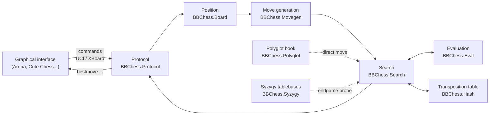

# 1. Introduction

A chess engine is a program that picks a move from a position. This chapter
explains what an engine is compared to a graphical interface, which components
it is made of, how the two standard protocols connect it to the outside world,
and how a command becomes a played move. BabaChess, a bitboard engine written in
Ada 2012, is the concrete example throughout the guide.

## 1.1 Engine and graphical interface

A chess engine is not a game with a window. It is a program without an interface
that reads commands on standard input and writes its answers on standard output.
It runs as a **command-line subprocess**: the graphical interface starts it,
talks to it in plain text, then stops it.

The graphical interface (GUI) is a separate program: Arena, Cute Chess, Lucas
Chess, XBoard, or a web interface. The GUI draws the board, handles the mouse and
the playing comfort, but it delegates all the computation to the engine. The
engine knows nothing about pixels; the GUI knows nothing about the search. This
separation is the basic contract of the ecosystem.

A real engine is therefore a plain executable. In BabaChess, it is
`bin/babachess`, built from `src/babachess.adb` (procedure `BabaChess`), which
reads the lines and hands them to the protocol driver `BBChess.Protocol`
(`src/bbchess-protocol.adb`).

## 1.2 The components of an engine

Every engine, however modest, assembles the same bricks. The table below sums
them up; the following chapters detail each one.

| Component | Role |
|---|---|
| Board representation | encode the position: pieces, side to move, castling, en passant |
| Move generation | list the legal moves of a position |
| Evaluation | score a position without searching, "who is better?" |
| Search | explore the move tree to choose the best move |
| Opening book | play the first moves by querying a database of games |
| Endgame tablebases | know the exact result of endgames |
| Time management | share the available time between the moves |

The **representation** is the first design choice. The "mailbox" representation
stores the position in an array of 64 squares and walks the directions piece by
piece. The **bitboard** representation describes each set of pieces with a
64-bit integer, one bit per square, and computes attacks with shifts and masks.
BabaChess moved from one to the other when it forked AdaChess, and uses 12
bitboards (one per piece type) plus the colour and total occupancies.

Above the representation, **move generation** produces the list of legal moves.
It is the most solicited brick: the search calls it at every node of the tree.
Chapter 2 is devoted to it.

**Evaluation** and **search** work together. Evaluation judges a frozen
position, search anticipates by exploring the possible replies. Splitting these
two roles cleanly is the mark of a readable engine.

## 1.3 The two protocols

The engine does not talk to the GUI directly: the two exchange through a
standard text protocol. Two of them exist, and both are still in use.

**UCI** (Universal Chess Interface) defines commands such as `uci`, `isready`,
`position`, `go` and `setoption`, and answers such as `uciok`, `readyok` and
`bestmove`. It is the dominant protocol today.

**XBoard/Winboard** is the older one. It uses `xboard`, `protover`, `setboard`,
`usermove`, `level` and `time`, and answers `move` instead of `bestmove`.

A single engine can speak both and choose according to the first command it
receives. BabaChess works that way: the `uci` command enables UCI mode, `xboard`
enables XBoard mode, and the whole dispatch lives in `BBChess.Protocol.Process`.

## 1.4 What makes an engine strong

An engine's strength comes down to a few well-known levers.

- **Search depth**: seeing further into the move tree often finds a better
  continuation. The useful depth depends on time and speed.
- **Evaluation quality**: a function that judges material, pawn structure or
  king safety finely steers the search toward good positions.
- **Speed**: expressed in nodes per second (nps or knps), it sets how many
  positions the engine examines per unit of time. An engine twice as fast
  searches roughly half a ply deeper.
- **Move ordering**: trying the probably good moves first makes alpha-beta
  pruning far more effective; it is often a free gain in depth.

These levers are measured, not guessed. Chapters 3 and 4 cover evaluation and
search, and chapter 7 covers the measurement tools.

## 1.5 Architecture and data flow

An engine reads like a chain: the protocol receives the command and loads the
position, generation produces the moves, the search tries them, evaluation
scores the leaves, and the best move travels back up to the protocol that sends
it out.

The position is a value passed from component to component, never a hidden
global state. The opening book and the tablebases are **side** services: they
are queried during the search, but they do not own the position.

## 1.6 The path of a move, end to end

The path of a move, in UCI mode, comes down to a few steps.

1. The GUI sends `position startpos moves e2e4 e7e5`, and the engine rebuilds the
   position.
2. The GUI sends `go wtime 60000 btime 60000`, with the allotted time.
3. `BBChess.Protocol.Process` splits the line and routes `go` to the move
   handling.
4. The parameters (`wtime`, `movetime`, `depth`, `nodes`) are parsed.
5. The book is probed first: if it holds a move, `bestmove` is sent back
   immediately. Otherwise the search starts.
6. The search generates the moves, orders them, evaluates the leaves and
   propagates the scores up the alpha-beta tree.
7. The best move is converted to coordinate notation and written as
   `bestmove e2e4`.
8. The GUI applies the move and sends the next position back; the loop starts
   again.

In XBoard mode the course is identical with other words: `usermove e2e4` plays
the opponent's move, `go` triggers the search, and the engine answers `move
e2e4`.

## 1.7 BabaChess as the example

BabaChess illustrates each of these points. It is a **bitboard** engine in **Ada
2012**, built with `gprbuild` from `babachess.gpr` into `bin/babachess`. It
speaks UCI and XBoard, manages a **Polyglot** book, probes **Syzygy** tablebases
(through the C library Fathom) and runs a multi-threaded **Lazy SMP** search.

Its structure follows the general scheme: `BBChess.Protocol` drives the session
and the commands, `BBChess.Movegen` generates the moves, `BBChess.Search`
searches, `BBChess.Eval` evaluates, and `BBChess.Hash` holds the transposition
table. The following chapters take each brick and examine it in that code.

## See also

- `src/doc/README.md`: overview of the architecture and index of the technical
  documentation.
- `src/doc/bitboards.md`, `recherche.md`, `evaluation.md`, `ouvertures.md`,
  `finales.md`: the components one by one.
- `src/babachess.adb`: entry point and command-line modes.
- `src/bbchess-protocol.adb`: command loop and UCI / XBoard dispatch.
- Neighbouring chapters: `02-board-and-movegen-en.md`, `03-evaluation-en.md`,
  `04-search-en.md`.
