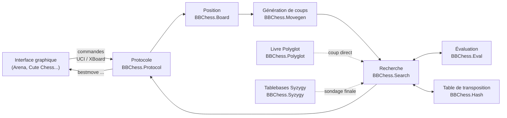

# 1. Introduction

Un moteur d'échecs est un programme qui choisit un coup à partir d'une position.
Ce chapitre explique ce qu'est un moteur par rapport à une interface graphique,
quels composants le constituent, comment les deux protocoles standards le
relient au monde extérieur, et par quel chemin une commande devient un coup joué.
BabaChess, moteur bitboard en Ada 2012, sert d'exemple concret tout au long.

## 1.1 Moteur et interface graphique

Un moteur d'échecs n'est pas un jeu avec une fenêtre. C'est un programme sans
interface qui lit des commandes sur l'entrée standard et écrit ses réponses sur
la sortie standard. Il vit en **sous-processus en ligne de commande** :
l'interface graphique le lance, lui parle en texte, puis l'arrête.

L'interface graphique (GUI) est un programme distinct : Arena, Cute Chess, Lucas
Chess, XBoard, ou une interface web. Le GUI dessine le plateau et capte la
souris, mais délègue tout le calcul au moteur. Le moteur ignore les pixels ; le
GUI ignore la recherche. Cette séparation est le contrat de base de l'écosystème.

Un moteur concret est donc un simple exécutable. Dans BabaChess, c'est
`bin/babachess`, construit depuis `src/babachess.adb` (procédure `BabaChess`) et
confié au pilote de protocole `BBChess.Protocol` (`src/bbchess-protocol.adb`).

## 1.2 Les composants d'un moteur

Tout moteur, même modeste, assemble les mêmes briques. Le tableau les résume ;
les chapitres suivants en détaillent chacune.

| Composant | Rôle |
|---|---|
| Représentation du plateau | encoder la position : pièces, trait, roques, prise en passant |
| Génération de coups | énumérer les coups légaux d'une position |
| Évaluation | estimer une position sans calcul, « qui est mieux ? » |
| Recherche | explorer l'arbre des coups pour choisir le meilleur |
| Livre d'ouvertures | jouer les premiers coups en consultant une base de parties |
| Tablebases de finales | connaître le résultat exact des fins de partie |
| Gestion du temps | répartir le temps disponible entre les coups |

La **représentation** est le premier choix de conception. La représentation
« mailbox » range la position dans un tableau de 64 cases et parcourt les
directions pièce par pièce. La représentation **bitboard** décrit chaque ensemble
de pièces par un entier de 64 bits, un bit par case, et calcule les attaques par
décalages et masques. BabaChess a migré de l'une à l'autre en forkant AdaChess :
12 bitboards (un par type de pièce) plus les couleurs et l'occupation totale.

Au-dessus de la représentation, la **génération de coups** produit la liste des
coups légaux. C'est la brique la plus sollicitée : la recherche l'appelle à
chaque nœud de l'arbre. Le chapitre 2 y est consacré.

L'**évaluation** et la **recherche** travaillent ensemble. L'évaluation juge une
position figée, la recherche anticipe en explorant les réponses possibles.
Découper proprement ces deux rôles est la marque d'un moteur lisible.

## 1.3 Les deux protocoles

Le moteur ne parle pas directement au GUI : les deux échangent par un protocole
textuel standard. Il en existe deux, encore tous deux en usage.

**UCI** (Universal Chess Interface) définit des commandes comme `uci`,
`isready`, `position`, `go` et `setoption`, et des réponses comme `uciok`,
`readyok` et `bestmove`. C'est le protocole dominant aujourd'hui.

**XBoard/Winboard** est le plus ancien. Il utilise `xboard`, `protover`,
`setboard`, `usermove`, `level` et `time`, et répond `move` au lieu de `bestmove`.

Un même moteur peut parler les deux et choisir selon la première commande reçue.
BabaChess fonctionne ainsi : la commande `uci` active le mode UCI, `xboard` le
mode XBoard, et tout le dispatch vit dans `BBChess.Protocol.Process`.

## 1.4 Ce qui fait la force d'un moteur

La force d'un moteur se joue sur quelques leviers bien identifiés.

- **La profondeur de recherche** : voir plus loin dans l'arbre des coups permet
  souvent de trouver une meilleure suite. La profondeur utile dépend du temps et
  de la vitesse.
- **La qualité de l'évaluation** : une fonction qui juge finement le matériel, la
  structure de pions ou la sécurité du roi oriente la recherche vers de bonnes
  positions.
- **La vitesse** : exprimée en nœuds par seconde (nps ou knps), elle fixe combien
  de positions le moteur examine par unité de temps. Un moteur deux fois plus
  rapide explore environ un demi-coup de plus.
- **L'ordonnancement des coups** : essayer d'abord les coups probablement bons
  rend l'élagage alpha-bêta bien plus efficace ; c'est souvent un gain gratuit en
  profondeur.

Ces leviers se mesurent, ils ne se devinent pas. Les chapitres 3 et 4 traitent de
l'évaluation et de la recherche, le chapitre 7 des outils de mesure.

## 1.5 Architecture et flux de données

Un moteur se lit comme une chaîne : le protocole reçoit la commande, charge la
position, la génération produit les coups, la recherche les essaie, l'évaluation
note les feuilles, et le meilleur coup remonte jusqu'au protocole qui le renvoie.

La position est une valeur transmise de composant en composant, jamais un état
global caché. Le livre et les tablebases sont des services **latéraux** : on les
consulte pendant la recherche, mais ils ne possèdent pas la position.

## 1.6 Le parcours d'un coup, de bout en bout

Le trajet d'un coup, en mode UCI, tient en quelques étapes.

1. Le GUI envoie `position startpos moves e2e4 e7e5`, et le moteur reconstruit la
   position.
2. Le GUI envoie `go wtime 60000 btime 60000`, avec le temps alloué.
3. `BBChess.Protocol.Process` découpe la ligne et route `go` vers la gestion du
   coup.
4. Les paramètres (`wtime`, `movetime`, `depth`, `nodes`) sont analysés.
5. Le livre est sondé d'abord : s'il contient un coup, `bestmove` est renvoyé
   immédiatement. Sinon la recherche démarre.
6. La recherche génère les coups, les ordonne, évalue les feuilles et fait
   remonter les scores dans l'arbre alpha-bêta.
7. Le meilleur coup est converti en notation coordonnée et écrit sous la forme
   `bestmove e2e4`.
8. Le GUI applique le coup et renvoie la position suivante ; la boucle
   recommence.

En mode XBoard, le déroulement est identique avec d'autres mots : `usermove
e2e4` joue le coup de l'adversaire, `go` déclenche la recherche, et le moteur
répond `move e2e4`.

## 1.7 BabaChess comme exemple

BabaChess illustre chacun de ces points. C'est un moteur **bitboard** en **Ada
2012**, construit avec `gprbuild` depuis `babachess.gpr` vers `bin/babachess`. Il
parle UCI et XBoard, gère un livre **Polyglot**, sonde les tablebases **Syzygy**
(via la bibliothèque C Fathom) et fait tourner une recherche multi-thread **Lazy
SMP**.

Sa structure suit le schéma général : `BBChess.Protocol` pilote la session et
les commandes, `BBChess.Movegen` génère les coups, `BBChess.Search` cherche,
`BBChess.Eval` évalue, et `BBChess.Hash` porte la table de transposition. Les
chapitres qui suivent reprennent chaque brique et l'examinent dans ce code.

## Voir aussi

- `src/doc/README.md` : vue d'ensemble de l'architecture et index de la
  documentation technique.
- `src/doc/bitboards.md`, `recherche.md`, `evaluation.md`, `ouvertures.md`,
  `finales.md` : les composants un par un.
- `src/babachess.adb` : point d'entrée et modes ligne de commande.
- `src/bbchess-protocol.adb` : boucle de commandes et dispatch UCI / XBoard.
- Chapitres voisins : `02-board-and-movegen-fr.md`, `03-evaluation-fr.md`,
  `04-search-fr.md`.
