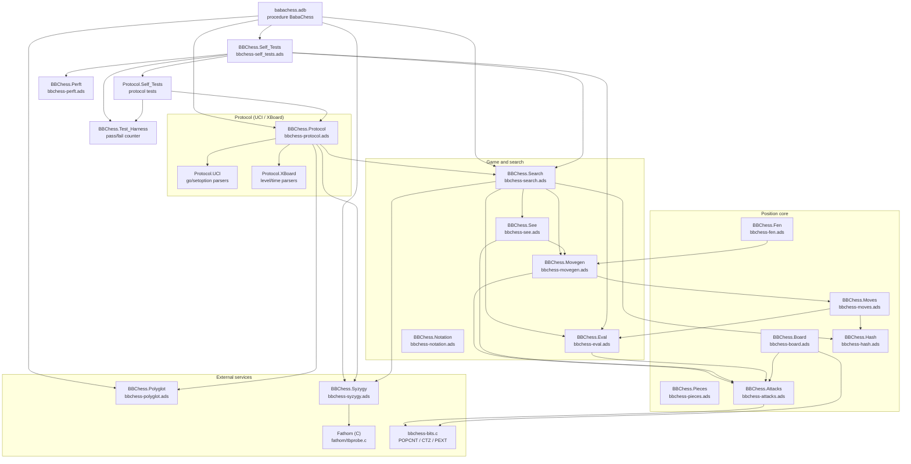
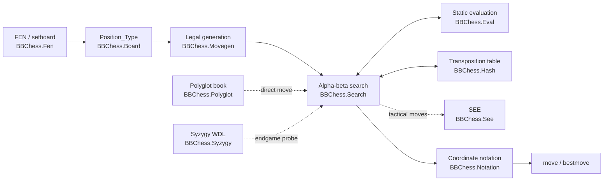

# BabaChess: engine documentation

BabaChess (BB) was born from the fork of the
[AdaChess](https://github.com/adachess/AdaChess) project, then from the conversion of the
**mailbox** board representation to a **bitboard** representation.
After many optimizations, it has become a project in its own right. It is
written in **Ada 2012**, lives in `src/` and builds through the project
`babachess.gpr` to the executable `bin/babachess`. The **mailbox** engine
of AdaChess (called **MB**) was **removed** from the repository at the time of the fork: its
perft values still serve as a validation reference. The engineering logging is
authoritative in `DEVELOPMENT.md` (root, in French; the pre-fork
part §1-§47 is archived in `DEVELOPMENT_HISTORY.md`);
`CHANGELOG.md` covers the engine versions.

> **AI-assisted development.** All the changes made to the project
> since the initial fork (engine, scripts, tests and documentation
> included) were carried out **with the help of AI agents**; **no development
> was done manually**. Main model: **DeepSeek V4.1 Flash**;
> corrections and additions provided by **prompts generated with Claude** and
> **Kimi K3**. Basic working tools: **opencode** (plugin
> **oh-my-openagent**) and **web interfaces**.

BB speaks **XBoard/Winboard and UCI** (the protocol is chosen by the command
`uci`). It handles a `level`/`time`/`otim` clock, a **Polyglot** opening book,
**Syzygy** tablebases (via vendored Fathom) and the **Lazy SMP** multi-threading.

## Architecture principles

The core of the engine is a **functional kernel without global state**: the packages
`BBChess.*` manipulate a `Position_Type` value passed as a parameter, never a
hidden variable. Only the search context and the precomputed tables
carry state, and it is explicitly reset (`Reset_Search`).

- **Representation**: 12 bitboards (one per piece) plus the colour/total
  occupancies, maintained incrementally by `Put_Piece` /
  `Remove_Piece`. Convention `BBChess.Board`: square = `rank * 8 + file`, a1 = bit 0,
  h8 = bit 63.
- **Attacks**: precomputed tables for the leapers (knight, king, pawns) and
  indexed lookup by occupancy mask for the sliding pieces
  (PEXT/BMI2, with software fallback in `portable` mode). The hardware
  bit operations are in the C shim `bbchess-bits.c`.
- **Moves**: a compact `Move_Type` (from, to, piece, promotion, flag)
  and a `Make_Move` / `Unmake_Move` pair in **snapshot + `Undo_Info`**, which
  makes the position copyable and simplifies perft, search and FEN.
- **Movegen**: "correctness first" strategy: pseudo-legal generation,
  then legality filter (pin mask when not in check). The
  separate tactical generator feeds the quiescence search.
- **Search**: iterative deepening with transposition table, PVS,
  ordering (hash move, MVV-LVA, killers, history), LMR, null-move,
  reverse futility, check extension and quiescence (SEE). The timed search
  is interruptible.
- **Evaluation**: material + PST interpolated by phase, completed by mobility,
  bishop pair, pawn structure, rooks and king safety. `Static` is
  symmetric; `Evaluate` adds a tempo bonus for the side to move.

### Package architecture



The **`BBChess.Protocol`** package carries the game session (position, repetition
history, clock, book) and the command dispatch; it **never** touches
`Ada.Text_IO`: each output line goes through a callback
(`Line_Writer`) provided by `babachess.adb`, which wires it to the console
lock of `BBChess.Search` (the same as the asynchronous UCI search task). Its
sub-packages `.UCI` and `.XBoard` contain only **pure parsers**, tested
without standard input.

### Data flow

Loading a position always goes through a `Position_Type` value.
`BBChess.Fen` initializes it, `BBChess.Movegen` reads it to produce the moves,
`BBChess.Search` makes it evolve by `Make_Move`/`Unmake_Move` and queries
`BBChess.Eval`. The transposition table, the Polyglot book and the Syzygy
tablebases are **auxiliary components** queried during the search, never
owners of the position.



## Command-line interface

| Mode | Effect |
|---|---|
| `--selftest` | Runs the internal suite (`BBChess.Self_Tests`): perft 1-5, Zobrist, packed moves, FEN validation, search, repetition, SEE, Polyglot key. Exit 0. |
| `--bench [depth]` | Searches 8 fixed positions at the given depth (default 8) and reports nodes, time and knps. |
| `--threads N` | Number of Lazy SMP search threads (1 to 16). The transposition table is shared, the heuristics are per thread. Equivalent forms: `-TN` and `--thread=N`. |
| `--book <file>` | Opens a Polyglot `.bin` opening book. Without the option, BB tries conventional locations (`books/book.bin`, executable directory, `~/.babachess/book.bin`). |
| `--syzygy <dir>` | Initializes the Syzygy tablebases via `BBChess.Syzygy.Init`. Inert without `.rtbw`/`.rtbz` files. |
| `--dump-params` | Displays the scalar evaluation parameters (`BBChess.Eval.Dump_Params`). |
| `--eval-fens <file>` | Reads one FEN per line (`FEN` or `FEN;result`) and prints the white-positive static evaluation, one integer per line. |
| `--params <file>` | Loads an evaluation parameter file; applies to **all** modes. |

`--params` applies to all modes. `--threads` concerns only the timed search of
the playing modes: `--selftest` and `--bench` ignore it. The options
`--book` and `--syzygy` are read before the mode selection, so they do open
the requested file; on the other hand `--selftest`, `--bench` and
`--eval-fens` return before the automatic loading of the default book and never
probe book or tablebases.

**Argument order**: the special modes (`--selftest`, `--bench`,
`--eval-fens`, `--dump-params`) are recognized as the **first argument**
(`Argument (1)`). `--params`, `--book`, `--syzygy` and `--threads` must therefore
be placed **after** the mode, e.g. `--bench 9 --params p.txt` and not
`--params p.txt --bench 9` (otherwise the mode is not recognized and the engine enters
the interactive loop).

In UCI mode, the same functions are exposed by `setoption` (`Hash`, `Threads`,
`OwnBook`, `BookFile`, `SyzygyPath`) and by `go` (`wtime`, `btime`, `winc`,
`binc`, `movetime`, `depth`, `nodes`, `infinite`). The UCI search is
**asynchronous** (Phase 5): the `go` runs in a task, so `isready`
answers `readyok` during the search, `stop` interrupts it (the current move is
returned immediately) and `quit` stops the search then exits. `go nodes N`
stops at the node ceiling and `go infinite` stops only on `stop` (or
`quit`). The XBoard search, meanwhile, remains synchronous.

## Building

```bash
gprbuild -P babachess.gpr -XMode=release    # -> bin/babachess (POPCNT/BMI2)
gprbuild -P babachess.gpr -XMode=checked    # -> bin/babachess (release + checks)
gprbuild -P babachess.gpr -XMode=portable   # -> bin/babachess (software fallback)
gprbuild -P babachess.gpr -XMode=debug      # -> bin/babachess (assertions)
```

`release` (default) compiles with `-mpopcnt -mbmi -mbmi2` and uses `_pext_u64`
for sliding attacks: it requires a BMI2-compatible processor. `portable`
removes these switches and uses the software fallback of `bbchess-bits.c`
(about 25% slower, but runs on any x86-64). The two modes share
`obj/`: after a `portable` build, do not compare `--bench` with a
`release` binary without `rm -rf obj`.

## Documentation index

- [bitboards-en.md](bitboards-en.md): board representation, pieces, attacks,
  Zobrist hashing and FEN reading (`BBChess.Board`, `BBChess.Pieces`,
  `BBChess.Attacks`, `BBChess.Hash`, `BBChess.Fen`).
- [evaluation-en.md](evaluation-en.md): static evaluation, phase, positional
  terms and adjustable parameters (`BBChess.Eval`).
- [recherche-en.md](recherche-en.md): move generation, make/unmake, SEE,
  alpha-beta, transposition table and Lazy SMP (`BBChess.Movegen`,
  `BBChess.Moves`, `BBChess.See`, `BBChess.Search`).
- [finales-en.md](finales-en.md): Syzygy tablebases via Fathom, WDL probe
  (`BBChess.Syzygy`, `src/fathom/`).
- [ouvertures-en.md](ouvertures-en.md): Polyglot opening book, compatible key
  and weighted probe (`BBChess.Polyglot`).
- [outils-et-tests-en.md](outils-et-tests-en.md): `--selftest`, perft, `--bench`,
  `--eval-fens`, `--params`, measurement scripts and SPRT.
- [build-and-cpu-en.md](build-and-cpu-en.md): build modes (`release`,
  `checked`, `portable`, `debug`), exact GNAT/C switches, alias
  `-T#`/`--thread=#` and CPU optimization history.
- `CHANGELOG_TECHNIQUE.md` (root): solidity / cleanliness / performance
  workstream (P0-P7), C cleanup, `Squares` invariant, warnings, `Piece_Values`,
  iterative SEE, factorization, 16-bit `Cont_History`.

## References

- Chess Programming Wiki: <https://www.chessprogramming.org/Main_Page>
- Universal Chess Interface: <https://www.chessprogramming.org/Universal_Chess_Interface>
- XBoard / Winboard protocol: <https://www.chessprogramming.org/XBoard>
- Lazy SMP: <https://www.chessprogramming.org/Lazy_SMP>
- TalkChess forum: <https://talkchess.com>

The detailed development log (choices, measurements, negative results,
current phase §48 and after) remains `DEVELOPMENT.md` at the root of the
repository; the pre-fork journey (§1-§47) is in `DEVELOPMENT_HISTORY.md`.
