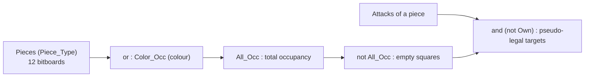
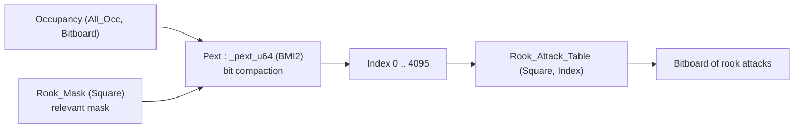
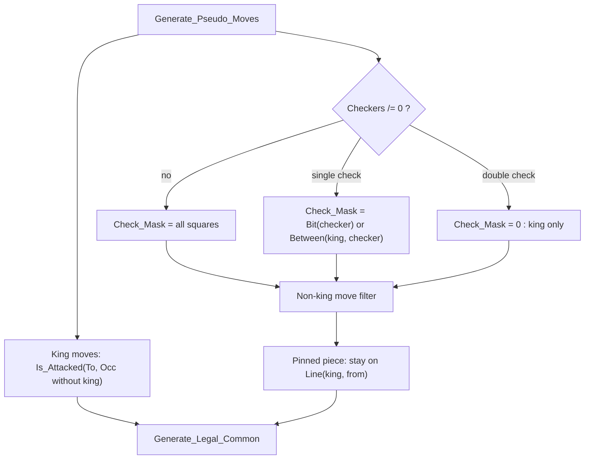

# Bitboards and attack generation

This document describes BabaChess's bitboard representation and the principles
of attack generation. It complements the engineering log
(`DEVELOPMENT.md`, sections 2, 7septies and 16). All the code cited lives in
`src/`, packages `BBChess.*`.

## 1. The Bitboard type

The heart of the representation lies in two declarations in
`bbchess-board.ads`: `subtype Square_Type is Natural range 0 .. 63;` and
`type Bitboard is mod 2 ** 64;`.

`Bitboard` is a 64-bit **modular type**: each bit represents a square. Set
operations are therefore done directly with the language's operators, without a
function call: `or` (union), `and` (intersection), `not` (complement),
`and not` (difference). That is 64 squares handled in one go.

### Square mapping

A square's index is `Rank * 8 + File`, with the following convention
(documented at the top of `bbchess-board.ads`):

- `File 0` = file A, `Rank 0` = rank 1 (White's back rank).
- `bit 0` = **a1**, `bit 63` = **h8**.
- Increasing the index goes north: `+8` per rank, `+1` per file.

```ada
function File_Of (Square : in Square_Type) return Natural is (Square mod 8);
function Rank_Of (Square : in Square_Type) return Natural is (Square / 8);
```

This convention (a1 at the LSB) is the exact mirror of MB's mailbox mapping
(`a8 = 21 ... h1 = 98`, `DEVELOPMENT.md` §3). The body of `BBChess.Board` also
precomputes a table `Bit : array (Square_Type) of Bitboard` where
`Bit (Square) := 2 ** Square`: this single-bit mask is used everywhere
(setting, clearing, membership tests).

## 2. Position: piece bitboards and occupancy

A `Position_Type` does not store one piece per square, but **twelve
bitboards**, one per concrete piece, plus the occupancies:

```ada
type Piece_Board_Array is array (Piece_Type) of Bitboard;
type Color_Board_Array is array (Color_Type) of Bitboard;

type Position_Type is record
   Pieces    : Piece_Board_Array := (others => 0);
   All_Occ   : Bitboard := 0;
   Color_Occ : Color_Board_Array := (others => 0);
   Side      : Color_Type := White;
   -- ... castling, en passant, counters, Zobrist, material
end record;
```

`Piece_Type` (in `bbchess-pieces.ads`) is ordered so that each colour occupies
a contiguous block of six values, `White_Pawn .. White_King` then
`Black_Pawn .. Black_King`; the functions `Color`, `Kind` and `Make` split it
and rebuild it by modular arithmetic.

`All_Occ` and `Color_Occ` are **not** recomputed by scanning: `Put_Piece`
updates them incrementally with
`Position.All_Occ := Position.All_Occ or Bit (Square)`, while
`Remove_Piece` clears the bit with `and (not ...)`. Since every mutation goes
through these two procedures, the occupancies stay consistent.

## 3. Basic setwise operations

Two primitives walk a bitboard without looping over the 64 squares:
`Lowest_Bit (Board)` (index of the least-significant bit, precondition
`Board /= 0`) and `Popcount (Board)` (number of bits). They are imported from
the C shim `bbchess-bits.c` (`__builtin_ctzll`, `__builtin_popcountll`),
exposed via `C_Ctz` and `C_Popcount`. Clearing the least-significant bit is done
directly, without an intrinsic: `Board and (Board - 1)`. Hence the iteration
pattern of move generation: `while Set /= 0 loop Sq := Lowest_Bit (Set); ...;
Set := Set and (Set - 1); end loop;`.



## 4. Leaper attacks: precomputed tables

Knight, king and pawns are **leapers**: their attacks do not depend on
occupancy. The sets are precomputed once and for all at elaboration, in
`bbchess-attacks.ads`. The tables are **private**; they are read through
`Inline` accessors bearing the same name (`Knight_Attacks (S)`, etc.), which
prevents any outside module from corrupting them after `Init` while keeping
zero cost at `-O3` (the accessors are fully inlined):

```ada
function Knight_Attacks (Square : in Square_Type) return Bitboard with Inline;
function King_Attacks   (Square : in Square_Type) return Bitboard with Inline;
function Pawn_Attacks   (Color : in Color_Type; Square : in Square_Type)
  return Bitboard with Inline;
```

The body of `BBChess.Attacks` starts from delta arrays `(DF, DR)`:
`Knight_Deltas` (the eight jumps) and `King_Deltas` (the eight directions).
Pawn attacks are built separately, because a white pawn attacks going up
(`R + 1`) and a black pawn going down (`R - 1`). `Build_Leaper`
applies each delta, checks `In_Board (F, R)` and sets
`Bit (Square_Of (F, R))`.

The result is an attack **without occupancy**: for a knight or a king, we then
intersect with `not Own` (and possibly `Enemy`) to get the targets. For pawns,
the relation is used in reverse: a white pawn attacking a square sits on a
square that a black pawn placed there would attack (see `Is_Attacked`).

## 5. Sliding attacks: PEXT lookup

Bishops, rooks and queens have attacks that **depend on occupancy**: a
blocker stops the ray. The chosen solution is indexing by `PEXT`
(BMI2), described in `DEVELOPMENT.md` §7septies. It replaced the magic
bitboards, with a notable gain: startup drops from about 1.9 s to
about 0.03 s, since there is **no more magic search** at run time.

### Principle

For each square and each slider type, `Slider_Mask` builds a
**relevant occupancy mask**: all squares reachable on the rays, except the
terminal edge squares (they never influence where the ray stops). Index sizes:
rook up to 12 relevant bits (`Max_Rook_Index = 4095`), bishop up to 9
(`Max_Bishop_Index = 511`).

`PEXT` extracts the occupancy bits falling inside the mask and compacts them
into an integer. It is a **bijection** between the subsets of the mask and the
indices `0 .. 2^n - 1`: no collision, hence no magic to search for. We index
the table directly:

```ada
function Rook_Attacks (Square : in Square_Type; Occupancy : in Bitboard)
  return Bitboard is
begin
   return Rook_Attack_Table
     (Square, Natural (Pext (Occupancy, Rook_Mask (Square))));
end Rook_Attacks;
```

`Queen_Attacks` has no table of its own: it is
`Rook_Attacks (Square, Occupancy) or Bishop_Attacks (Square, Occupancy)`.



### Building the tables

`Build_Rook_Table` and `Build_Bishop_Table` fill their tables for each square
by enumerating the subsets of the mask. The pattern
`Sub := (Sub - 1) and Mask` enumerates them in strictly decreasing order, and
each subset is stored at `Pext (Sub, Mask)`.

`Sliding_Attacks` is the naive version, used **only at construction time**: it
advances ray by ray and stops at the first occupied square (the blocker is part
of the attacks). At run time, nobody walks the rays anymore: a `PEXT` followed
by a memory access is enough.

### `Between` and `Line` tables

The same mechanism precomputes two square tables for check detection and pins:
`Between (A, B)` (squares strictly between A and B, empty if not aligned) and
`Line (A, B)` (the full line through A and B, endpoints included). They are
computed from the sliding attacks on an empty board, for example
`Between (A, B) := Rook_Attacks (A, Bit (B)) and Rook_Attacks (B, Bit (A))`.

## 6. Move generation

`BBChess.Movegen` exploits these tables. `Generate_Pseudo_Moves` produces
pseudo-legal moves, then `Generate_Legal_Common` filters for legality.

### Pawns: generation by bulk shifts

Pawn pushes and captures are computed for **all pawns at once**, by bitboard
shift. Since the mapping puts the rank in the high-order bits, advancing one
rank amounts to multiplying or dividing by 256. For example for White:

```ada
Push1 := (Pawns * 256) and Empty;                        -- single push
Dbl   := ((Push1 and White_Push_Rank) * 256) and Empty;  -- double push
Caps_L := ((Pawns and not File_A_BB) * 128) and Enemy;   -- left diagonal capture
Caps_R := ((Pawns and not File_H_BB) * 512) and Enemy;   -- right diagonal capture
```

The black versions divide by 256 and 512/128. `File_A_BB` and `File_H_BB` are
file masks precomputed in `BBChess.Attacks`: they avoid captures that would
"wrap around" from one edge to the other. Promotions come out through
`Emit_Promotions` (queen, rook, bishop, knight).

For the other pieces, we iterate their bits then remove the friendly squares:
`Targets := Bishop_Attacks (From, Occ) and not Own;`, and likewise
`King_Attacks (From) and not Own` for the king. Castling is added separately,
after checking that the intermediate squares are free and not attacked.

### Legality filter

`Generate_Legal_Common` avoids a systematic make/unmake:

1. `Attackers_To` enumerates the enemy pieces attacking the king, which gives
   the `Checkers` bitboard.
2. In **single check**, `Check_Mask` is the square of the checker plus
   `Between (king, checker)`: the move must capture or block. In **double
   check**, `Check_Mask = 0`, only the king can move.
3. `Pin_Mask` computes the **absolutely pinned** pieces from the king's rays:
   a piece is pinned when it is the sole blocker between its king and an enemy
   slider of compatible direction.
4. A non-king move is kept only if it falls inside `Check_Mask` and, if the
   piece is pinned, if it stays on `Line (king, from)`.
5. The king cannot go to an attacked square. The test is done by
   removing the king from the occupancy (`Occ_No_King`), to count discovered
   attacks.
6. **En passant capture** goes through a full make/unmake, because it can
   uncover an attack along the rank.



## 7. Perft validation

`BBChess.Perft` is the correctness oracle. The recursive function `Nodes`
counts the leaves of a legal-move tree: depth 0 returns 1,
depth 1 returns `Count` directly, otherwise it enumerates the moves, calls
`Make_Move`, descends to `Depth - 1`, then `Unmake_Move`.

Perft exercises exactly the building blocks described here: attack tables,
legality filter, make/unmake. If a sliding ray skips a blocker, if a
file mask is wrong or a pin is forgotten, the count drifts.
`--selftest` compares the expected values with the engine's:

| Position | Depth | Expected |
|---|---|---|
| Initial | 1 to 5 | 20, 400, 8 902, 197 281, 4 865 609 |
| Castling | 1 to 3 | 48, 2 039, 97 862 |
| En passant | 1 to 3 | 14, 191, 2 812 |
| Promotions | 1 to 2 | 44, 1 486 |

Perft is also cross-checked against MB, the repository's mailbox engine, an
independent oracle (`DEVELOPMENT.md` §2 and §4). The project's golden rule:
**any change to movegen, search or evaluation must keep `--selftest` green
and the perft counts unchanged.**

## 8. The two build modes

**`release`** compiles Ada and C with `-O3 -mpopcnt -mbmi -mbmi2`. `Pext`,
imported from C, resolves to the hardware instruction `_pext_u64` (the shim is
compiled with `__BMI2__` defined), and `Popcount` / `Lowest_Bit` use POPCNT
and TZCNT. This binary **requires a CPU with BMI2/POPCNT**: on an older
processor it would stop on an illegal instruction.

**`portable`** keeps `-O3 -gnatN` but **removes** `-mpopcnt -mbmi -mbmi2`
on both the Ada and the C side. As `__BMI2__` is no longer defined, `baba_pext`
falls back to a software loop that walks the bits of the mask and rebuilds the
result bit by bit; `__builtin_popcountll` and `__builtin_ctzll` fall back on
the libgcc routines. The binary then runs on any x86-64.

### Why the two modes are identical

A **single file** `bbchess-bits.c` serves both modes: the only
difference is the `__BMI2__` macro, so the semantics of `baba_pext` stay the
same (same bijection, same index). The tables built at elaboration
are bit-for-bit identical, and move generation does not know the
build mode.

This is measured in `DEVELOPMENT.md` §16: `--bench 9` gives **the same tree**
(780 851 nodes) in both modes, only the throughput changes (about
1.46 M knps in `release` versus 1.07 M in `portable`, about 27% slower).
`--selftest` stays green, perft 1 to 5 unchanged. Note: the two
modes share `obj/`, so do not mix builds in one tree.

## References

- [Bitboards, Chess Programming Wiki](https://www.chessprogramming.org/Bitboards)
- [General Setwise Operations, Chess Programming Wiki](https://www.chessprogramming.org/General_Setwise_Operations)
- [Sliding Piece Attacks, Chess Programming Wiki](https://www.chessprogramming.org/Sliding_Piece_Attacks)
- [Magic Bitboards, Chess Programming Wiki](https://www.chessprogramming.org/Magic_Bitboards)
- [Bit Scanning, Chess Programming Wiki](https://www.chessprogramming.org/Bit_Scanning)
- [Perft, Chess Programming Wiki](https://www.chessprogramming.org/Perft)
