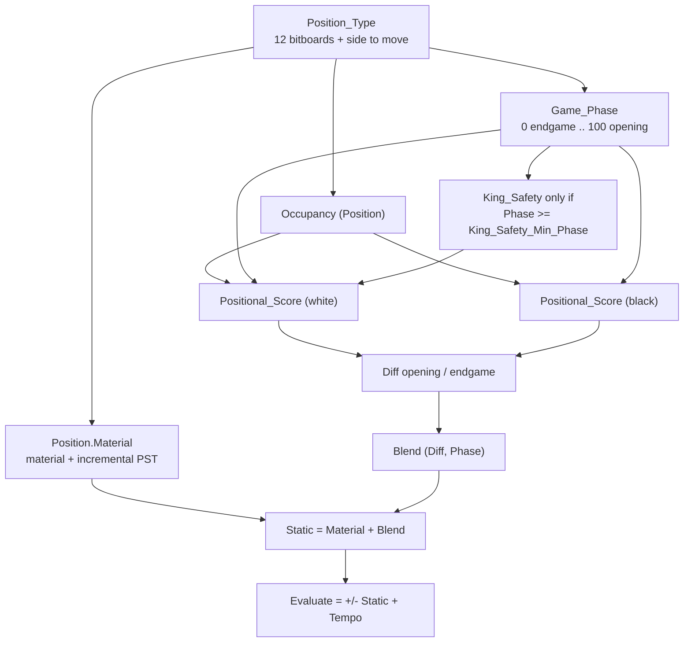
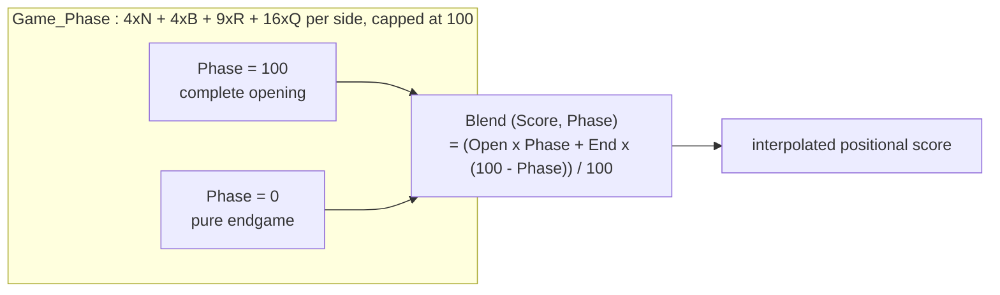

# Static evaluation in BabaChess

The evaluation lives in `BBChess.Eval` (`src/bbchess-eval.ads` / `.adb`). It
produces a score in **centipawns**, positive when White is better. Negamax
queries `Static (Position)`, the core without tempo that is strictly
antisymmetric, and `Evaluate (Position)`, `Static` brought back to the point of
view of the side to move plus the tempo bonus. `Infinity` and `Mate_Score` are
`30_000`. The package has no branch dedicated to "White" or "Black": that is the
key to symmetry (see below).

## 1. Pipeline overview



The flow of `Static` is linear: `Result := Position.Material` (material total +
**incremental** PST, maintained by `Make_Move` / `Unmake_Move`), `Game_Phase`
and `Occupancy` computed once then shared, `Positional_Score` called for White
and Black, the two vectors **subtracted** term by term, finally `Blend`.
`Evaluate` orients `Static` toward the side to move and adds `Tempo`.

## 2. Material and piece-square tables (PST)

The material values come from `Params` via `Piece_Value`: `P_Pawn` 100,
`P_Knight` 320, `P_Bishop` 330, `P_Rook` 500, `P_Queen` 900, king 0.

Each piece has an 8×8 `PST_Table`: `Pawn_PST`, `Knight_PST`, `Bishop_PST`,
`Rook_PST`, `Queen_PST`, `King_PST`. `PST` reads the table in the colour's frame
of reference: a white piece uses `Rank_Of (Square)`, a black one
`7 - Rank_Of (Square)`. The rows go from the back rank (0) toward the opponent's
side (7), so **a single table serves both sides** without duplication. The PSTs
encode positional knowledge: knight penalised on the edges, bishop drawn to the
long diagonals, rook on the 7th, `King_PST` that keeps the king castled and
`King_End_PST` that centralises it in the endgame.

To shorten the hottest material loop, `Rebuild_Material_PST` precomputes at
elaboration `Material_PST (Piece, Square) = Piece_Value + PST`.
`Material_PST_Value` feeds `Make_Move`, `Compute_Material` recomputes the full
total (init after `Load`, self-test check), and `Set_Param` rebuilds the flat
table if the modified value is a material one.

## 3. "Tapered" evaluation (opening / endgame interpolation)

Each positional term is not a single constant: it is evaluated **twice**, for
the opening and for the endgame, then interpolated. The type
`Tapered_Score_Type` carries the `Opening` / `End_Game` pair; `Both`, the `"+"`
operator and `Blend` compose these pairs:



`Game_Phase` follows the classic count: 4 per knight, 4 per bishop, 9 per rook,
16 per queen, for both sides, capped at 100. The starting position is worth 100,
a kings-and-pawns endgame is worth 0. The point of tapering: each term behaves
differently depending on the phase. The bishop pair is worth 20 then
45 (`P_Bishop_Pair_Op` / `P_Bishop_Pair_Eg`); a rook on the 7th goes from 15 to
35 (`P_Rook7_Op` / `P_Rook7_Eg`); passed pawns have **two tables** whose bonus
climbs from 5 to 130 cp with the rank; the king is corrected in the endgame by
`King_End_PST (K_Row, K_File) - PST (King, ...)`, a zero difference in the
opening that becomes a centralising bonus. `Both` duplicates a single value in
both fields (the mobility case).

## 4. Positional terms, computed per colour

The positional evaluation sits in `Positional_Score`, **generic over colour**:
calling it with White then Black and subtracting the result stays symmetric. It
receives `Occ` (the occupancy, computed once) and returns the king-danger output
parameters (`Near_Danger`, `Far_Danger`, `Attackers`) consumed by `King_Safety`.
Since P3.1, its terms are **six named local functions** (`Bishop_Pair_Term`,
`Mobility_Term`, `Connected_Rooks_Term`, `Pawn_Structure_Term`,
`Pawn_Threats_Term`, `King_Activity_Term`), so that each can be measured and
tuned individually; their sum reproduces the original arithmetic (identical
behaviour verified).

### 4.1 Bishop pair and mobility

If `Popcount (Pieces (Color, Bishop)) = 2`, a tapered bonus is added
(`Bishop_Pair_Opening` / `Bishop_Pair_Endgame`), stronger in the endgame.

For each knight, bishop, rook and queen, `Piece_Attacks` produces the reachable
squares according to the occupancy and we count
`Popcount (Piece_Attacks and Free)` where `Free` excludes the squares occupied
by one's own pieces **and the squares attacked by an enemy pawn** (mobility
area, `P_MOB_AREA`, enabled since §73 of `DEVELOPMENT.md`). Mobility is
**weighted by phase**: the opening weights are `Mobility_N` (4), `Mobility_B`
(4), `Mobility_R` (2), `Mobility_Q` (1), and the endgame weights
`Mobility_N_Eg`, `Mobility_B_Eg`, `Mobility_R_Eg`, `Mobility_Q_Eg` (default
**equal** to the opening weights, so a neutral taper by default). Knight and
bishop are the most sensitive to their freedom, the queen is lightly weighted so
as not to single-handedly "compensate" a passive position.

### 4.2 Rooks (7th, open, semi-open, connected files)

Still within the mobility loop, a special treatment of rooks:

- **7th rank**: if `Own_Row (Color, Sq) = 6`, bonus `Rook_On_7th_Opening` /
  `Rook_On_7th_Endgame`, plus `Rook_On_7th_King` if the enemy king is still on
  its two back ranks (`Own_Row (Enemy, Enemy_King) <= 1`);
- **open file** (no pawn, friendly or enemy): `Rook_Open_File_Opening` /
  `Rook_Open_File_Endgame`;
- **semi-open file** (no friendly pawn): `Rook_Semi_Open_Opening` /
  `Rook_Semi_Open_Endgame`;
- **connected rooks**: if the two rooks defend each other on the same line
  (`Rook_Attacks (R1, Occ) and RR` non-zero), `Rook_Connected_Opening` /
  `Rook_Connected_Endgame`.

The detection goes through `File_Mask`, without a per-pawn loop, and the enemy
king's square is hoisted out of the loop.

### 4.3 Pawn structure

This part is entirely bitboard-based:

- **doubled pawns**: for each file,
  `Popcount (Own_Pawns and File_Mask (F))`; beyond the first pawn, penalty
  `(-Doubled_Pawn_Opening)` / `(-Doubled_Pawn_Endgame)` per extra pawn;
- **isolated pawns**: no friendly pawn on the adjacent files
  (`Own_Pawns and Adj = 0`), penalty `(-Isolated_Pawn_Opening)` /
  `(-Isolated_Pawn_Endgame)` per pawn;
- **passed pawns**: detected by `Passed_Pawns`, which relies on
  `Front_Blockers`. The latter widens the enemy pawns to their neighbouring files
  (`East_1` / `West_1`) then propagates them rank by rank (`South_1` /
  `North_1`): a pawn with a free front is passed. Seven fixed shifts,
  without a per-pawn traversal;
- bonus per rank `Passed_Pawn_Opening (Row)` / `Passed_Pawn_Endgame (Row)`;
- **protected**: `Defended_By_Pawn` detects a friendly pawn on the back-defence
  squares (`Pawn_Attacks (Opposite (Color), Square)`) and adds a fraction of the
  passed bonus (`Protected_Passed_Opening` / `Protected_Passed_Endgame`);
- **distant**: a passed pawn `Outside_Passed_Distance` (2) files or more from
  the enemy king receives `Outside_Passed_Opening` / `Outside_Passed_Endgame`.
- **rear pawn of a doubled pair** (`P_Passed_Rear`): a pawn that has a friendly
  pawn in front of it on its file is not counted as passed;
- **blocked** (`P_Passed_Blocked`, 56% after Texel tuning, §72): if the stop square (in front of the pawn)
  is occupied, only this fraction of the per-rank bonus is kept;
- **king proximity** (endgame, own rank ≥ 3): with the king distance
  `D` to the stop square capped at 5 and the weight `W = 5·Row - 13`, the endgame
  receives `(D_enemy × P_PKing_Them - D_friend × P_PKing_Us) × W / 8`
  (29 and 16 by default since the Texel tuning, §72).

The other terms added in §70 of `DEVELOPMENT.md` (reduction of drawn endgames,
hanging pieces, connected/backward pawns, king safety ramp) exist as parameters
but are **disabled** by default: measured without gain, including after tuning
their weights (§73). The mobility area, meanwhile, is enabled (§73).

### 4.4 King activity in the endgame

In the opening, the king's contribution to the positional score is zero:
`King_PST` does the work. In the endgame, the interpolated correction is
`King_End_PST (K_Row, K_File) - PST (King, Color, King_Sq)`, which progressively
recentres the king.

### 4.5 King safety (sensitive term, frozen)

`King_Safety` is only added if `Phase >= King_Safety_Min_Phase` (20): it is an
opening / middlegame term, **currently considered sensitive and left frozen**.
The version in place computes:

- two precomputed zones around the king: `Near_Zone` (distance 1, the king's
  square included so that a check counts) and `Far_Zone` (distance 2, half
  weight);
- a **non-linear** danger `- (Near_Danger * (Attackers + 1)) / 2 - Far_Danger`,
  `Near_Danger` summing `P_Atk_N` (10), `P_Atk_B` (10), `P_Atk_R` (16),
  `P_Atk_Q` (24): a coordinated attack weighs more than the sum of the
  attackers;
- `P_Exposed` (28) if the king has left its back rank;
- a **pawn shield** on the king's wing (files 0..2 or 5..7):
  `P_Shield1` / `P_Shield2` / `P_Shield3` according to the rank of the most
  advanced pawn, or `P_OpenFile` if the file is empty;
- a **pawn-storm**: `P_Storm` per advanced enemy pawn (ranks 3..5) on the king's
  wing.

A central king receives neither shield nor storm: it is already punished by the
middlegame PST. Why "frozen": two reworkings were tried then **reverted**
(`DEVELOPMENT.md` § 17). The "strong" version (5×5 zone, weighted attack units,
quadratic danger) and the "surgical" version (far zone ÷2, capped quadratic) did
fix the targeted blunder but regressed in strength: the surgical one lost
**161-80-59 (≈ 96 Elo)** in a 300-game SPRT, a confirmed regression. The lesson
recorded: a good king-safety term requires a **finer model** (genuinely active
attackers, phases, open lines) **and automatic tuning**, not a patch of
constants. As long as this model does not exist, the current form is kept.

### 4.6 Threats

The `threats` term, in `Positional_Score`, is computed per colour (hence
symmetric) and covers two cases: each non-pawn enemy piece attacked by a
friendly pawn yields `P_Threat_Pawn * Piece_Value (Kind (Pc)) / 100`; a knight or
a bishop attacking an enemy rook or queen yields
`P_Threat_Minor * Piece_Value (Kind (Pc)) / 100`. Both parameters are in
`Params`. `DEVELOPMENT.md` § 9.4 notes that the gain measured against GNU
(≈ 1.5/30 before, ≈ 3.5/30 after) stays **within the noise** at this sample
size: timed, non-deterministic search makes small differences unmeasurable
without a real SPRT of several hundred games. The term is kept, with this caveat
documented.

## 5. Tempo

`Tempo` is 10 cp; `Evaluate` always adds it to the side to move:

```ada
if Position.Side = White then
   return Static (Position) + Tempo;
else
   return -Static (Position) + Tempo;
end if;
```

This bonus avoids some zugzwang artefacts. It deliberately breaks the exact
antisymmetry of `Evaluate`, hence the following point.

## 6. Symmetry property and verification

The evaluation must be **symmetric**: flipping the board (rank mirror) while
swapping the colours must change the sign of the score, a guarantee that neither
side is favoured by a code asymmetry. Three design rules ensure this: the PSTs
read the rank in the colour's frame of reference (`Rank_Of` or `7 - Rank_Of`), so
a single table serves both sides; `Positional_Score` is generic over colour and
the two `Tapered_Score_Type` vectors are **subtracted** before `Blend`; `Static`
adds nothing that depends on the side to move. Since `Evaluate` adds `Tempo`, the
exact symmetry bears on **`Static`**: `Static (M) = -Static (P)` when `M` is the
mirror of `P`. Self-test invariants:

```
Static (Start_Position) = 0
Evaluate (Start_Position) = Tempo   (White to move)
Static (mirror) = -Static (original)
```

`bbchess-self_tests.adb` implements `Check_Symmetry (Fen)`: it reloads the
position, builds its mirror (traversal of the bitboards, `Flip_Rank` +
`Opposite (Color)`), recomputes `Compute_Material` on the mirror, then
`Assert (Static (M) = -Static (P))`. Three FENs exercise different terms:
`4k3/8/8/8/8/8/4P3/4K3 w - - 0 1` (passed pawn, kings);
`r1bq1rk1/pp3ppp/2n1pn2/2pp4/3P1B2/2NBPN2/PPPQ1PPP/2KR3R w - - 0 1` (mobility,
bishop pair, files); and `4k3/6R1/8/8/8/8/6r1/4K3 w - - 0 1` (rooks, 7th, rook
against rook). Any new evaluation must remain symmetric: that is the golden
rule (`DEVELOPMENT.md` § 8). The self-test also verifies the consistency of
`Position.Material` (incremental) with `Compute_Material`.

## 7. Tunable parameters and tooling

All the scalar constants of the evaluation are grouped in the `Params` array of
type `Param_Array`. The named constants of the code (`Bishop_Pair_Opening`,
`Mobility_N`, `Rook_On_7th_Opening`, `Pawn_Shield_Row1`, `King_Attack_Queen`,
`Threat_Pawn`, etc.) are `renames` on `Params`, so the rest of the evaluation
does not change. `bbchess-eval.ads` exposes `Set_Param (Name, Value)` (e.g.
`"P_Mobility_N 5"`, rebuilds `Material_PST` if the value is a material one),
`Load_Params (File_Name)` and `Dump_Params`.

On the command-line side: `--dump-params` prints the table, `--params <file>`
loads a set before any mode without a rebuild, and `--eval-fens <file>` outputs
the white static evaluation of each FEN to feed a tuner.

The 44 identifiers of `Param_Id` cover the material, the bishop pair, mobility
(opening and endgame weights, `P_Mobility_*` / `P_Mobility_*_Eg`), the rooks
(7th, files, connected), the pawn structure, king safety and threats. The
protected passed bonuses have their own identifiers (`P_Protected_Op` /
`P_Protected_Eg`, alias `Protected_Passed_Opening` / `Endgame`) that weight the
passed bonus in `Positional_Score`.

## 8. Design choices and accepted negative results

Several decisions are **deliberate**:

- **Default values kept despite the Texel tuning.** `DEVELOPMENT.md`
  § 7sexies: over 240 self-play games (5,801 positions), `scripts/tune.py`
  (Texel-style coordinate descent, `sigmoid (K * eval / 400)`, `K = 1.13`)
  lowers the objective (train 0.1025 → 0.0950; validation 0.1033 → 0.0951) but
  the resulting set **regresses by about 147 Elo** in A/B against the defaults.
  § 21: on the Lichess CC0 dataset (100,000 human positions), the MSE drops
  further (train 0.2173 → 0.2141) but the 30-parameter set loses **≈ 38 Elo** in
  a 300-game SPRT (117-84-99, LOS 99%). Conclusion: MSE stays **disconnected
  from playing strength**; the defaults are kept deliberately.
- **SPSA as the remaining avenue.** `scripts/spsa.py` compares two parameter
  sets with the **same binary** via `--params` wrappers, perturbs
  35 parameters (excluding material) and optimises the actual game outcomes. Any
  winning set will have to pass a 300-game SPRT before adoption.
- **Asymmetric tempo accepted.** It is a choice; symmetry is guaranteed on
  `Static`.
- **King safety frozen.** The term brought a gain in blitz (§ 7bis) but two more
ambitious extensions regressed in SPRT (§ 17) and were reverted: the current
model is stable, not optimal.
- **Non-incremental phase.** A phase maintained by `Make`/`Unmake` was
  implemented then reverted (§ 12): the 8 `Popcount` of `Game_Phase` weigh
  ~0.2% of the time and the added field made the `Position` copies heavier.
- **Material imbalance (Kaufman) switched off.** A term
  `(bishops - knights) × missing pawns` per side (`P_Imb_KBNB`, default 0) was
  added then measured **-8.3 ± 13.5 Elo** (SPRT inconclusive, `DEVELOPMENT.md`
  § 85): not kept, left as a neutral switch like `P_Hanging_*` /
  `P_Connected`.

In summary, BB's evaluation is deliberately **simple, safe and symmetric**:
material + PST interpolated by phase, plus classic positional terms computed
bitboard-style. The enrichment attempts that did not pass the SPRT were removed
or frozen.

## References

- [Evaluation](https://www.chessprogramming.org/Evaluation)
- [Piece-Square Tables](https://www.chessprogramming.org/Piece-Square_Tables)
- [Tapered Eval](https://www.chessprogramming.org/Tapered_Eval)
- [Mobility](https://www.chessprogramming.org/Mobility)
- [Pawn Structure](https://www.chessprogramming.org/Pawn_Structure)
- [King Safety](https://www.chessprogramming.org/King_Safety)
- [Automated Tuning](https://www.chessprogramming.org/Automated_Tuning)
