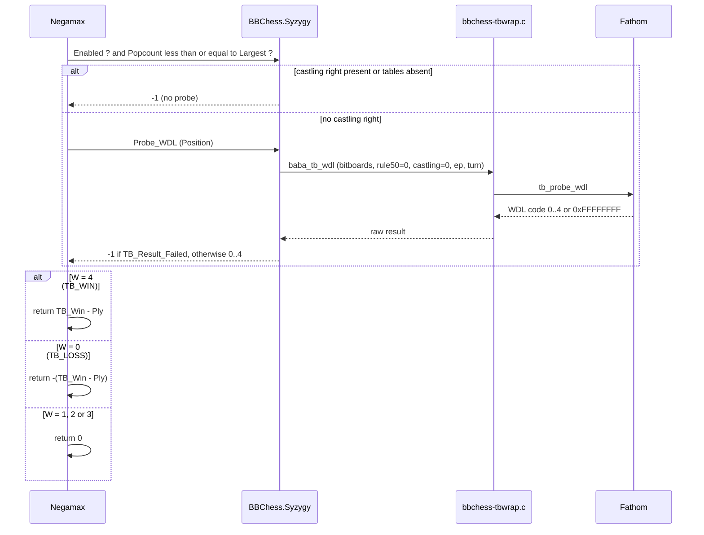
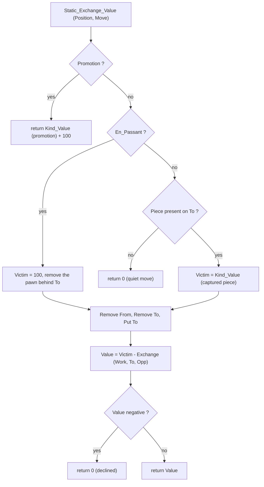
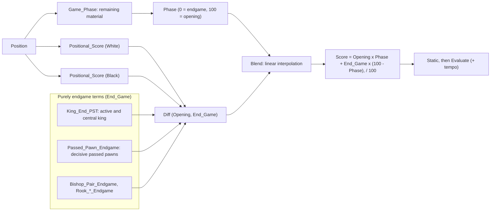

# Endgames, tablebases and static exchange evaluation

This document describes the BabaChess components related to endgames: the
**Syzygy tablebases** of `BBChess.Syzygy` (bindings to the **Fathom** C
library), the **static exchange evaluation** (SEE) of `BBChess.See`, and the
**phase-based evaluation scaling** of `BBChess.Eval`. It explains the retained
principles, not every function. BB is the bitboard engine (`src/`); MB (`src/`)
serves here only as a reference.

## 1. Why tablebases

In the endgame, heuristics show their limits: a won KQvK endgame can be missed,
a fortress misjudged, and the 50-move rule easily lost sight of. **Endgame
tablebases** give the exact result of every legal position when few pieces
remain. BabaChess reads the **Syzygy** format (`.rtbw` files for the result,
`.rtbz` for the distance), not shipped with the engine: without them, the
integration remains totally inert.

### 1.1 WDL: the only metric used

Syzygy offers several measures; BB uses only the **WDL** (*Win / Draw / Loss*),
the theoretical result seen from the side to move, ignoring the 50-move rule.
Fathom returns five WDL codes (`0` loss, `1` blessed loss, `2` draw, `3` cursed
win, `4` win) plus `16#FFFF_FFFF#` (probe impossible). The *blessed loss* /
*cursed win* distinction comes from the fact that WDL assumes `rule50 = 0`; BB
treats these two cases as draws, a cautious approximation and not perfect play.

## 2. Integration into the search

### 2.1 The Ada binding

`BBChess.Syzygy` is a thin layer above the C wrapper
`src/fathom/bbchess-tbwrap.c`, itself above Fathom. The wrapper exposes four flat
symbols: `baba_tb_init`, `baba_tb_free`, `baba_tb_largest` and `baba_tb_wdl`
(the probe, called with one bitboard per piece type). The Ada API fits in five
subprograms: `Init (Path, Ok)`, `Free`, `Largest`, `Enabled` and
`Probe_WDL (Position) return Integer`. `Init` returns `Ok = False` if no usable
table is found; in that case `Largest = 0` and `Enabled = False`. `Probe_WDL`
converts the `Position` into Fathom bitboards (`Color_Board`, `Position.Pieces`,
`Position.En_Passant`) and returns the WDL code 0..4 or `-1`.

### 2.2 Where and how the probe is called

The probe is at the start of `Negamax` (`bbchess-search.adb`), after repetition
detection. It is only attempted if `BBChess.Syzygy.Enabled` and
`Popcount (Position.All_Occ) <= BBChess.Syzygy.Largest` (material guard). The
WDL code is then converted: `4` (TB_WIN) becomes `BBChess.Syzygy.TB_Win - Ply`;
`0` (TB_LOSS) becomes `-(BBChess.Syzygy.TB_Win - Ply)`; `1 | 2 | 3` (draw /
blessed / cursed) becomes `0`; any other code lets the search continue normally.

`TB_Win = 20_000`: this bound (opposites `-20_000` / `0`) is below the mate score
and above any normal evaluation. Subtracting the ply makes near wins preferred
and delays losses. The loop stops as soon as `Abs (Best_Score)` reaches
`TB_Win - 100`.

### 2.3 Sequence diagram of a probe

## 3. Explicit limits

These limits are deliberate, documented in `DEVELOPMENT.md` § 14 and in the
binding headers. They are not to be presented as features.

- **WDL only, no DTZ.** BB never probes the distance to conversion:
  `tb_probe_root` is not called. In a won endgame, the engine may therefore
  "spin" without progressing and let a draw slip away through the 50-move rule.
  Adding a DTZ probe at the root is identified but not done.
- **No castling rights.** `Probe_WDL` rejects the position as soon as one of the
  four rights remains (`-1`): the WDL tables do not describe them.
- **Halfmove ignored.** `Probe_WDL` always sends `Rule50 => 0`; respecting the
  50-move rule exactly would require DTZ.
- **Inert without files.** Without `.rtbw` / `.rtbz`, `Init` fails, `Largest`
  stays 0, `Enabled` is false: the probe is never reached, `--bench` unchanged.
- **No perfect play beyond WDL.** `TB_Win - Ply` is a direction, not a proof of
  an optimal line.

Smoke test: with the 3-piece tables, a white KQvK returns 19999 from depth 2.

## 4. Configuration

**Command line** (playing modes): `./bin/babachess --syzygy /path`,
and **UCI**, live before `go`:
`setoption name SyzygyPath value /path/to/tables`. In both cases the value is
passed to `BBChess.Syzygy.Init`. The path may contain several directories
separated by the platform separator (`:` under Unix, `;` under Windows). An
invalid path is not fatal: `Ok` is false and the engine continues without
tables. `--book` and `--syzygy` only concern the playing modes.

## 5. SEE: static exchange evaluation

The SEE of `BBChess.See` answers a narrow question: *if I start the capture
sequence on a square, what net material gain results, assuming both sides reply
with their cheapest attacker?* The result is in centipawns, from the point of
view of the side to move.

### 5.1 Principle

Public function: `Static_Exchange_Value (Position, Move) return Score_Type`.
Private building blocks: `Kind_Value` (pawn 100, knight 320, bishop 330, rook
500, queen 900, king 10,000), `Attackers_Of`, `Weakest` (cheapest unpinned
attacker) and `Exchange` (recursive minimax).

The model, shared with MB: both sides recapture only on the destination square,
choosing their least valuable attacker; **pinned** pieces (`Pin_Mask`) do not
take part; a recapture can be **declined** (0), so a losing sequence is
abandoned; and the **king is only the last attacker**.

X-rays (bishop, rook, queen masked by the captured piece) appear naturally,
because `Exchange` works on a **mutable copy** of the position and updates the
occupancy at each step (`Remove_Piece`, `Put_Piece`). Promotions, quiet moves
(value 0) and en passant captures (pawn removed behind the destination) are
handled separately.

### 5.2 Uses and verification

SEE is used in two places in `bbchess-search.adb`, to **prune or prove**, never
as an evaluation. First the **quiescence**: a capture whose SEE is negative is
skipped (except promotions and evasions out of check); delta pruning is added
there. Then **ProbCut**: a tactical move is only tried if its SEE reaches
`ProbCut_Margin`. An old SEE-based ordering was removed (about 13% fewer knps,
`DEVELOPMENT.md` § 9.3). The self-test covers: undefended piece (+500), equal
exchange (0), knight against defended pawn (-220), pinned defender ignored
(+900), en passant capture (+100).

### 5.3 Flow diagram

## 6. Evaluation scaling: the endgame terms

`BBChess.Eval` has no isolated "remaining material" term, but the whole
positional evaluation is **interpolated by phase**: it is what gives the endgame
terms their specific treatment.

### 6.1 Game phase and interpolation

Each term is computed twice, an opening value and an endgame one, carried by
`Tapered_Score_Type` (`Opening`, `End_Game`). `Blend` interpolates:
`(Score.Opening * Phase + Score.End_Game * (100 - Phase)) / 100`. `Phase` comes
from `Game_Phase`, computed on the remaining material
(`4 × (knights + bishops) + 9 × rooks + 16 × queens`, capped at 100). So
`Phase = 100` in a complete opening, `Phase = 0` in a pure endgame: when the
pieces disappear, the endgame values take over. The computation is done per
colour then mirrored, which preserves symmetry (zero at the start, opposite
mirrored position).

### 6.2 Terms with an endgame component

The `_Eg`-suffixed constants are `rename`s on `Params`, hence tunable at runtime
by the tuner: `Bishop_Pair_Endgame`, `Rook_Open_File_Endgame`,
`Rook_Semi_Open_Endgame`, `Rook_Connected_Endgame`, `Rook_On_7th_Endgame`,
`Doubled_Pawn_Endgame`, `Isolated_Pawn_Endgame`, `Protected_Passed_Endgame` and
`Outside_Passed_Endgame`. The **passed pawns** have two tables; the bonus climbs
toward promotion in the endgame (0, 12, 22, 38, 60, 90, 130 depending on the
rank for `Passed_Pawn_Endgame`, versus 0, 5, 8, 12, 16, 22, 30 for
`Passed_Pawn_Opening`).

**King activity** is a special case: `King_End_PST` replaces the middlegame PST.
The correction `King_End_PST (K_Row, K_File) - PST (King, Color, King_Sq)` pushes
the king toward the centre in the endgame; carried only by `End_Game`, it fades
as the phase rises. **King safety** is conversely an opening term: it is only
added if `Phase >= King_Safety_Min_Phase` (20).

### 6.3 Scaling diagram

## 7. In summary

The tablebases give an **exact WDL** for few pieces, via Fathom, but **without
DTZ or castling** and **inert without files**. **SEE** estimates the gain of a
sequence and serves to prune (quiescence, ProbCut), not to evaluate. The
**evaluation** interpolates opening and endgame by phase.

## References

- Syzygy Bases: <https://www.chessprogramming.org/Syzygy_Bases>
- Endgame Tablebases: <https://www.chessprogramming.org/Endgame_Tablebases>
- Static Exchange Evaluation:
  <https://www.chessprogramming.org/Static_Exchange_Evaluation>
- Fathom (Jon Dart), Syzygy probing (MIT):
  <https://github.com/jdart1/Fathom>
- Internal log: `DEVELOPMENT.md` § 14 (tablebases) and § 5.2 (*tapered*).
- Sources: `src/bbchess-syzygy.*`, `src/bbchess-see.*`,
  `src/bbchess-eval.adb`, `src/fathom/`.
