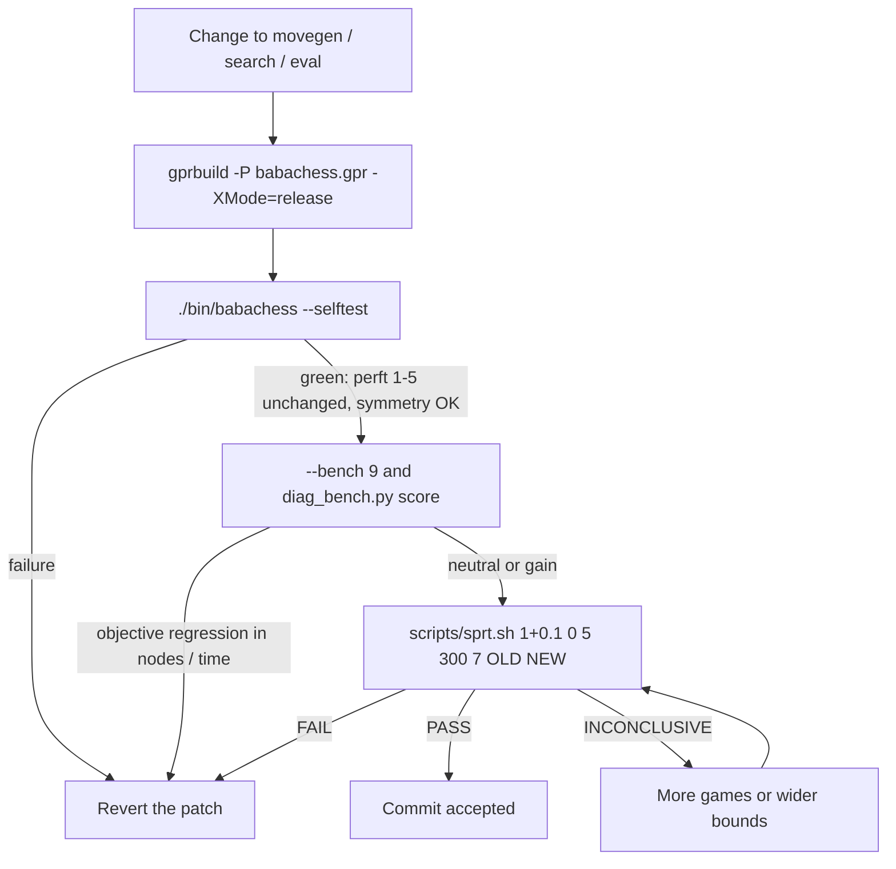
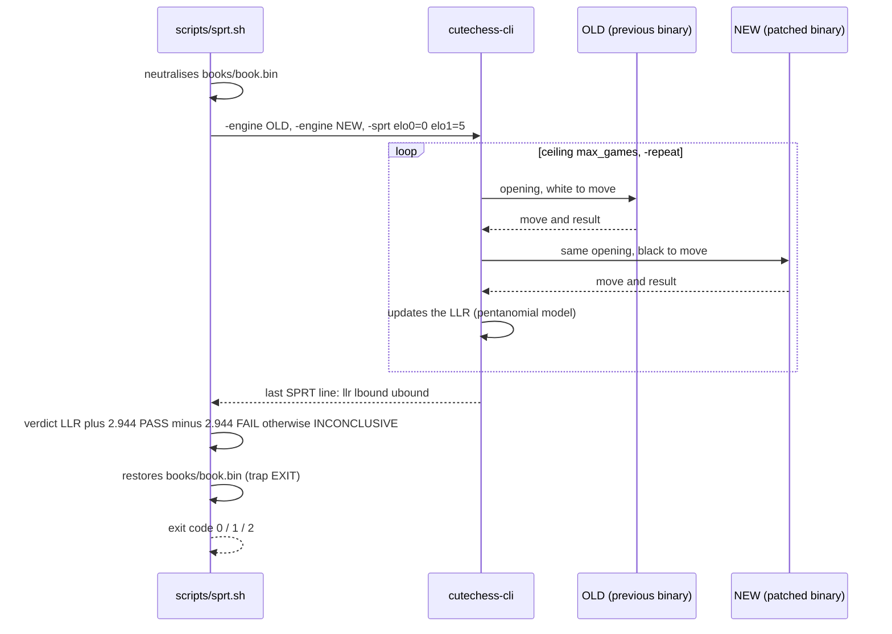
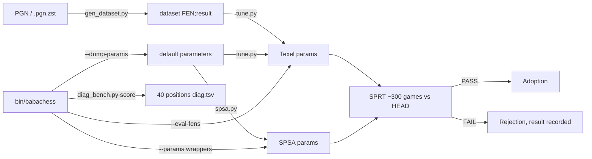

# Tools and tests: keeping the engine honest

BabaChess has neither a test framework nor continuous integration. The truth of
a change is measured with three instruments: `--selftest` (correctness),
`--bench` (machine cost) and SPRT (real strength). This document explains how
they fit together and which rules keep you from telling yourself stories.

## The principle: correctness first, decisions after

A patch can be fast, elegant and wrong. The order of evaluation is therefore
fixed:

1. **Correctness**: `--selftest` must pass and the perft counts must **never**
   regress. No exception.
2. **Cost**: `--bench` and the diagnostic bench check that the patch does not
   trade a strength regression for a higher node count.
3. **Strength**: `scripts/sprt.sh` is the only judge of a playing improvement.

A change never skips step 1, and no strength conclusion is ever drawn from a
short match.



## `--selftest`: the internal suite

```bash
./bin/babachess --selftest    # exit 0 if everything passes
```

The mode returns before the automatic loading of services orchestrated by
`babachess.adb`: it opens neither the default book nor tablebases (an explicit
`--book` / `--syzygy` option, read earlier, would however open the requested
file). `BBChess.Self_Tests.Run` (`bbchess-self_tests.adb`) runs, in order:

- **Bitboard primitives and attacks**: bit 0 = a1, bit 63 = h8, `Popcount`,
  leaper tables, `Between`/`Line`, and attack counts for the sliders.
- **Movegen and make/unmake**: 20 legal moves at the start, a 1.e4 round trip
  with restoration of the occupancy and of the en passant square.
- **Perft 1 to 5** from the initial position: 20, 400, 8 902, 197 281 and
  4 865 609 nodes, plus castling, en passant and promotion positions.
- **Event-based castling rights**: a king that leaves e8 and then returns loses
  its rights on both sides; a rook that moves removes only its own.
- **Incremental Zobrist**: after 40 real moves, the maintained key equals
  `Hash.Compute` and the incremental material follows.
- **Packed moves**: `Unpack_Move (Pack_Move (M)) = M` over all moves.
- **FEN validation**: a FEN leaving the side not to move in check, or without
  a king per side, is **rejected** (`Constraint_Error`).
- **Evaluation**: `Static` at the start is 0 and the mirror of a position gives
  `-Static` (three FENs, including rooks on the 7th and passed pawns).
- **Search**: `Best_Move` at depth 3 returns a legal move; with a 0.1 s budget
  it returns a legal move in under 2 s (no loss on time under a GUI).
- **Repetition**: with the current position seen twice, the search returns a
  legal move, then `Reset_Search` clears the history.
- **SEE**: undefended piece (+500), equal exchange (0), minor for a pawn
  (−220), pinned defender ignored (+900), en passant capture (+100).
- **Polyglot key**: five FENs compared against the reference values (start,
  castling, en passant capturable or not, middlegame).
- **Polyglot book hardening**: missing, empty, truncated or invalid-size file
  (rejected with a precise status) and a valid entry (loaded); none of them
  crashes or returns an illegal move.
- **Protocol layer** (`BBChess.Protocol.Self_Tests`): pure parsers for `go`,
  `setoption`, `level`, `time` (valid, malformed and absent values) and captured
  dispatch (`uci`, `isready`, `position startpos|fen`, rejected FEN,
  `protover`, `ping`, empty line, `quit`, bare move). None of them starts a
  search.

Success/failure is counted by **`BBChess.Test_Harness`**: every false check is
reported (`FAILED: ...`) without interrupting the suite, the final tally prints
`N checks passed, M failed`, and **a single failure sets the exit code** to
non-zero (so CI really fails). Otherwise the output ends with
`all self tests OK`, exit code 0. The total is **136 checks**.

## Perft: the correctness oracle

`BBChess.Perft.Nodes` is a plain recursion of `Generate_Legal_Moves` +
`Make_Move`/`Unmake_Move`. Its value is threefold: the **known values** from the
CPW (20, 400, 8 902, 197 281, 4 865 609) hard-coded, the **historical oracle**
(AdaChess's mailbox engine, removed at the fork, against which the engine was
validated — not only against constants), and the **internal invariant** (a perft
unchanged after a movegen patch proves that move generation has not moved).

A perft that changes signals a rules regression, never an improvement. The
golden rule is explicit in `DEVELOPMENT.md` §8: any change (movegen, search,
eval) must keep perft and self-tests green, and any new evaluation must stay
**symmetric** (eval at the start = 0). The symmetry test applies to `Static`;
`Evaluate` adds a tempo bonus for the side to move, so it is not antisymmetric.

## `--bench`: reproducible machine cost

```bash
./bin/babachess --bench       # depth 8 by default
./bin/babachess --bench 9     # 8 fixed positions, nodes / time / knps
```

`Run_Bench` in `babachess.adb` loads eight frozen FENs, searches them at a fixed
depth with a reset TT (`Reset_Search`, `Reset_Nodes`), and reports nodes, time
and knps. The work is deterministic, so two binaries compare exactly. Reference
quoted in §18: **780 851 nodes** at `--bench 9`. The `portable` build gives the
same tree (~27% slower); both modes share `obj/`, so do not mix builds without
`rm -rf obj`.

## Evaluation modes: `--eval-fens`, `--params`, `--dump-params`

These three modes are for tuning and do not open a playing engine:

- `--dump-params` prints `Name Value`, one line per scalar parameter.
- `--eval-fens <file>` reads a FEN per line (or `FEN;result`) and prints the
  static evaluation **white-positive**, one integer per line. An invalid FEN
  prints `0`.
- `--params <file>` loads a parameter set before **any** mode.

They are the only way to modify the evaluation without a rebuild, which the
tuning exploits heavily.

## `--threads`: Lazy SMP

```bash
./bin/babachess --threads 4 --bench 9
```

`--threads N` sets the number of search tasks (1 to 16), also adjustable via
UCI (`setoption name Threads value N`). The transposition table is shared,
killers, history and counters are per thread, the stop flag is atomic. To
measure, keep the time budget identical: SMP increases CPU usage, not the move
time.

## SPRT: the decision tool

A fixed-size A/B of 20 to 60 games gives contradictory gaps (±65-80 Elo): it can
settle nothing. The script replaces that with a sequential test (Wald) driven by
`cutechess-cli -sprt`.

```bash
scripts/sprt.sh [tc] [elo0] [elo1] [max_games] [seed] [old] [new]
# defaults:           1+0.1  0     5     2000        7     ~/bin/adachess_bb  bin/babachess
```

Hypotheses: **H0**, NEW does not exceed OLD by `elo0` (→ FAIL); **H1**, NEW
exceeds OLD by at least `elo1` (→ PASS). After each game the LLR is compared to
the bounds `ln((1-β)/α)` and `ln(β/(1-α))`; with α = β = 0.05 they are ±2.944.
Verdicts and exit codes: `PASS` (H1 accepted, code 0), `FAIL` (H0 accepted, code
1), `INCONCLUSIVE` (ceiling reached, code 2).

Each opening from `openings/openings.epd` is played **twice, colours reversed**
(`-games 2 -rounds max_games/2 -repeat`) to remove the colour bias and decorrelate
the games. The script **neutralises `books/book.bin`** for the whole match and
restores it via `trap ... EXIT`, because the default book lookup looks next to
the executable and its parent: a binary in `bin/` would find the book, a binary
in `/tmp` would not.

**To validate a patch, pass the previous binary as OLD**:

```bash
scripts/sprt.sh 1+0.1 0 5 300 7 /tmp/opencode/previous_build bin/babachess
```

Comparing directly against the `bb-1.0` reference gives an immediate PASS, since
the gap is about +300 Elo.



### The ~300-game rule

A **HEAD vs HEAD** check (identical binaries) over 40 games gave 41.2%, an
apparent gap of ±60 Elo: the error bar at 40 games is **±87 Elo**. At **300
games** it drops to **±33-36 Elo**. So **never** decide below ~300 games; only
the objective gaps from `--bench` (nodes/time) can discard a candidate sooner. A
FAIL is useful information: a neutral patch (±2 Elo) is rejected quickly and at
low cost.

## `scripts/ab.sh` and `scripts/vs_gnuchess.sh`: the thermometer, not the judge

```bash
scripts/ab.sh 1+0.1 20 7           # bb-1.0 reference vs HEAD, tc, games, seed
scripts/vs_gnuchess.sh 30+1 12 7   # vs GNU Chess (UCI), tc, games, seed
```

`ab.sh` pits `~/bin/adachess_bb` (frozen reference) against `bin/babachess`,
with the book neutralised as well. `vs_gnuchess.sh` takes on GNU Chess
(~2400-2500 Elo) through the wrapper `~/bin/gnuchess_uci.sh`, since GNU Chess
6.2.7 never emits `feature done=1` in XBoard mode. These two scripts are
**machine-local** and their score over 20 to 60 games is worth ±65-80 Elo of
noise: an intuition, never a decision.

## `scripts/diag_bench.py`: the multi-position bench

Optimising a single position (the `f6g5` blunder of §17-18) led to dead ends.
The diagnostic bench replaces the single position with a **global thermometer**
of 40 positions taken from games lost against GNU, each annotated with
Stockfish's expected move.

```bash
python3 scripts/diag_bench.py build   [--pgn F ...] [--depth 12] [--max 40]
python3 scripts/diag_bench.py score --binary bin/babachess [--depth 14]
```

`build` keeps the graduated errors (loss of 1 to 6 pawns, to avoid a bench
saturated with mates) and writes `bench/diag.tsv`. `score` replays each position
with a **fresh BB process** (isolated TT, `OwnBook=false`, hence reproducible)
and reports the rate of correct moves and the average loss vs Stockfish, bounded
at ±10 pawns. The bench depends on `python-chess` and on Stockfish
(`/usr/games/stockfish`). Documented baseline: **11/40 correct moves (28%),
average loss +0.33 pawn**. It is a non-regression check complementing
`--selftest`: you never target an isolated position, you watch the average.

## Tuning: `scripts/spsa.py`, `scripts/tune.py`, `scripts/gen_dataset.py`

The two tuners optimise parameter sets loaded by `--params` (hence without a
rebuild) from a dataset.



**`gen_dataset.py`** converts PGNs (plain or `.pgn.zst`, decompressed on the
fly) into `FEN;result` lines from White's point of view, one move in four after
the opening. **`tune.py`** is a Texel tuner by coordinate descent: it minimises
the sigmoid error `sigmoid(1.13 · eval / 400)` vs result, a candidate being kept
only if it improves **both train AND validation** (1 position in 5). It drives
the engine through `--eval-fens` and `--params`:

```bash
python3 scripts/gen_dataset.py --max 100000 /tmp/opencode/lichess_dataset.txt \
    /tmp/opencode/lichess_2013-01.pgn.zst
python3 scripts/tune.py /tmp/opencode/lichess_dataset.txt --rounds 6 \
    --out /tmp/opencode/tuned_lichess.txt
```

Documented result, **negative**: the MSE drops (train 0.2173 → 0.2141 over 100k
positions) but the resulting play loses ≈ 38 Elo in a 300-game SPRT. The MSE
stays disconnected from strength; the default parameters were kept.

**`spsa.py`** optimises the **actual game result** instead of the static error.
It compares two parameter sets with the **same binary** via `--params`
wrappers, perturbs 35 eval parameters at once (material excluded), plays an A/B
match and updates the SPSA step
(`c_k = c0/(k+1)^0.101`, `a_k = 6/(k+1+10)^0.602`). The book is neutralised and
restored even on a signal, with a snapshot at each iteration:

```bash
python3 scripts/spsa.py --iterations 50 --games 200 --tc 1+0.1 \
    --binary bin/babachess --out /tmp/opencode/spsa
```

A useful run lasts hours. Whatever the tuner, the final play must be
**re-validated by a ~300-game SPRT** at real time control, never adopted on the
MSE alone. The tuner proposes, the SPRT disposes. The SPRT of a `--params` set
goes through a wrapper, as `spsa.py` generates:

```bash
printf '#!/bin/sh\nexec "$PWD/bin/babachess" --params /tmp/opencode/tuned_lichess.txt "$@"\n' \
    > /tmp/opencode/tuned_wrap.sh && chmod +x /tmp/opencode/tuned_wrap.sh
scripts/sprt.sh 1+0.1 0 5 300 7 "$PWD/bin/babachess" /tmp/opencode/tuned_wrap.sh
```

## Decision rules, in summary

1. `--selftest` green and perft unchanged: **mandatory** before any match.
2. Any new evaluation stays **symmetric** (`Static` at the start = 0).
3. Decide nothing below ~300 games: at 40, the error bar is ±87 Elo.
4. `scripts/sprt.sh` is **the decision tool**; `ab.sh` and `vs_gnuchess.sh` are
   noisy thermometers.
5. `--bench` and `diag_bench.py` are non-regression controls, not optimisation
   targets. You never target an isolated position.
6. A tuner that lowers the MSE is not enough: the resulting play goes back
   through an SPRT.

## References

- Perft: <https://www.chessprogramming.org/Perft>
- SPSA: <https://www.chessprogramming.org/SPSA>
- Automated tuning (including Texel): <https://www.chessprogramming.org/Automated_Tuning>
- Engine testing: <https://www.chessprogramming.org/Testing>
- TalkChess forum: <https://talkchess.com>
- Engineering log, sections 7sexies, 15, 19, 20 and 21: `DEVELOPMENT.md`
  at the repository root.
