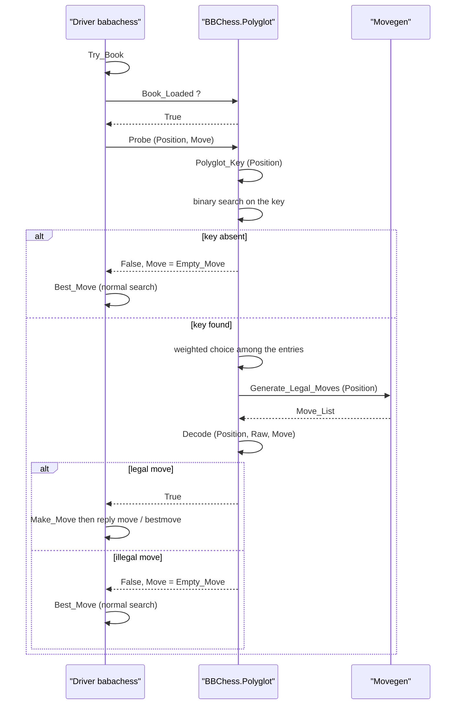
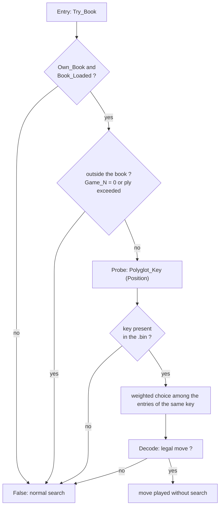

# Openings and the Polyglot book

An engine without a book is prone to weak moves: BB, left to its own
devices, kept returning to `1.Nc3`, a mediocre opening that the static
evaluation does not penalise early enough. The opening book corrects exactly
this bias. It does not think, it computes nothing: it plays a known move and
hands back control. It is an auxiliary component, just like the Syzygy tablebases,
consulted **before** the search takes over.

The module is called `BBChess.Polyglot` and lives in `bbchess-polyglot.ads` /
`bbchess-polyglot.adb`. It implements the standard **Polyglot `.bin`** format,
compatible with the ecosystem of engines and GUIs, which allows reusing public
books without conversion.

## The Polyglot `.bin` format

A Polyglot book is a plain binary file, with no header and no separate index.
It contains a series of **16-byte** entries, all in big-endian format, and
**sorted by increasing key**:

| Offset | Size | Field | Role |
|---|---|---|---|
| 0 | 8 | `key` | Polyglot Zobrist key of the position |
| 8 | 2 | `move` | encoded move (from, to, promotion) |
| 10 | 2 | `weight` | relative frequency of the move |
| 12 | 2 | `learn` | reserved, ignored by BB |

`Open_Book` reads the file entry by entry and fills an in-memory array
(`Book_Array`). Sorting by key is the central property: it allows a **binary
search** on the key, hence a probe in `O(log n)`, without having to walk the
hundreds of thousands of entries of a large book. The package's header comment
restates this contract: *16-byte entries, big-endian, sorted by key*.

The move encoding, done in `Decode`, fits in 16 bits:

- `from = (raw / 64) mod 64`, `to = raw mod 64`, with the square convention
  `a1 = 0` up to `h8 = 63`;
- `promo = (raw / 4096) mod 8`, where `1` = knight, `2` = bishop, `3` = rook,
  `4` = queen, `0` = none.

The `weight` field serves as a relative probability during the choice: a move
played often in the base weighs more than a rare one. BB ignores the `learn`
bytes.

## The Polyglot Zobrist key

To find a position in the book, it is not enough to compute any Zobrist key: you
need **the same key** as the one produced by the book generators. The Polyglot
format therefore fixes a precise convention, which `Polyglot_Key` reproduces.

The function has an embedded table `Polyglot_Random`, indexed from 0 to 780 (781
constants). The body's comment states that these values come from the reference
implementation and are generated from `python-chess`. The distribution of the
indexes is as follows:

| Index | Content |
|---|---|
| 0 to 767 | pieces on squares |
| 768 to 771 | castling rights: white short, white long, black short, black long |
| 772 to 779 | en passant, one constant per file |
| 780 | side to move |

**Piece encoding.** For a piece of type `kind` (pawn=0, knight=1, bishop=2,
rook=3, queen=4, king=5) and of given colour, the index in the table is:

```
Idx = 64 * (2 * kind + Colour) + Square
```

where `Colour` is 1 for White and 0 for Black: **even** indexes denote Black,
odd ones White. This is a historical trap of the format, noted in
`DEVELOPMENT.md`; inverting it gives wrong keys, which the cross-check test
detected immediately. `Kind_Index` maps `Pawn..King` to `0..5` before building
`Idx`.

**Conditional en passant.** Polyglot adds the file constant only if a pawn of the
side to move can **really capture** the target square. The code tests the attack
mask (`South_1`/`West_1` for White, `North_1` for Black) against the pawns of the
side to move, and applies the XOR only if the intersection is non-empty. The
legality of the capture does not come into play, only the geometric possibility
counts: that is the reference definition. A FEN with an `ep` square but no
attacking pawn therefore produces a different key from the same position without
the `ep` square, which the test verifies.

**Side to move.** A single final XOR (`Polyglot_Random (780)`) is applied only
when White is to move.

### Why this key differs from `BBChess.Hash`

BB already has a Zobrist hash, `BBChess.Hash.Compute`, used as the transposition
table key. The book cannot use it, and the two keys are **deliberately
independent**:

| | `BBChess.Hash` | `Polyglot_Key` |
|---|---|---|
| Table | generated by an internal LCG | 781 frozen constants of the format |
| Pieces | 12 types × 64 squares | `64 * (2*kind + colour) + square` |
| Side to move | `Side_Key` | index 780 |
| Castling | `Castle_Key (colour, side)` | indexes 768 to 771 |
| En passant | key per file, **unconditional** | key per file, **conditional** |

The transposition table has no external compatibility constraint: its seed and
its layout are specific to BB. The book, however, must match byte for byte what
the external generators produced. That is why `Polyglot_Key` is a separate
function, with its own table, rather than a variant of `Compute`.

## The course of a probe

The probe does not live in `BBChess.Polyglot` alone: the driver, `babachess.adb`,
first decides **whether to consult** the book. The function `Try_Book` centralises
this decision:

1. if `Own_Book` is false, or if `Book_Loaded` returns false, we give up;
2. if the current position is too far advanced, we also give up. The test
   `Game_N = 0 or else Game_N - 1 > Book_Max_Ply` limits the book to
   `Book_Max_Ply = 16`, i.e. the opening over **16 half-moves**. `Game_N` counts
   the game keys recorded; `Game_N - 1` is therefore the index of the current
   half-move. Beyond that, the search takes over;
3. otherwise `Probe` is called, and the move is kept only if it is non-empty.

`Probe` then does the work:

- it computes `Polyglot_Key (Position)`;
- it finds the lower bound of the key by **binary search** in the sorted array,
  then checks that the key at that position is indeed identical;
- it scans the **contiguous entries with the same key** and sums their weights,
  each weight being floored at 1 (`Natural'Max (Book (I).Weight, 1)`), so that an
  entry with zero weight remains playable;
- it draws a random number in that sum and selects the corresponding entry:
  this is the **weighted choice**;
- it decodes the move via `Decode`, which generates the legal moves of the
  position and returns `True` only if the raw move corresponds to a move that is
  **actually legal**. A stale entry, an impossible move or a badly encoded
  promotion returns `False`, and the book is considered silent on that position.

The important point is that the probe never returns an illegal move: the
legality check is the last filter, not a mere courtesy. A book may contain
positions or moves that no longer match the state of the game; `Decode` protects
against that.

### Sequence diagram



### Decision diagram



## Configuration

Three routes open a book.

**Command line.** `--book <file>` calls `Open_Book` on the given path. BB
applies this choice before the default loading, so an explicit `--book` wins.

**Conventional locations.** Without `--book`, `Load_Default_Book` tries six
candidates in order and keeps the first readable one:

1. `books/book.bin` (relative to the current directory);
2. `books/book.bin` in the executable's directory;
3. `books/book.bin` in the parent directory of the executable;
4. `~/.babachess/book.bin`;
5. `book.bin` (current directory);
6. `book.bin` in the executable's directory.

If a book is already loaded, `Load_Default_Book` does nothing: the explicit
`--book` is not overwritten.

**UCI.** Two options are declared by the `uci` command:

- `OwnBook` (type `check`, default `true`): `setoption name OwnBook value false`
  cuts the book without unloading it, by acting on `Own_Book`;
- `BookFile` (type `string`, default `books/book.bin`): `setoption name BookFile
  value <path>` directly calls `Open_Book`.

The latter is handy for a GUI that wants to change the book mid-session without
restarting the engine.

**Data source.** `scripts/fetch_book.sh` downloads a **CC0** book and installs
it under `books/book.bin`. The script requires `curl` and `zstd`, downloads the
archive `https://www.chesswob.org/jja/books/<name>` then decompresses it. The
default file is `lichess-201301-202303-gm2600.bin.zst` (grandmaster games);
`lichess-201301-202303-2800+.bin.zst` and
`lichess-201301-202303-magnus.bin.zst` are offered as variants. The CC0 licence
is compatible with the project's GPLv3. The `.bin` is never committed:
`.gitignore` excludes `books/*`.

## Book verification

The book is not loaded by `--selftest`, `--bench` or `--eval-fens`: these modes
return before `Load_Default_Book`. BB therefore verifies the part that can
really fail, in isolation, the **Zobrist key**, and compares it against reference
values.

`BBChess.Self_Tests.Run` contains a dedicated block that loads a FEN, calls
`Polyglot_Key` and compares the result against constants produced by the
reference implementation (`python-chess`):

| Position | Expected key |
|---|---|
| initial position | `16#463B96181691FC9C#` |
| castling available | `16#FDA239CC692A6053#` |
| en passant capturable | `16#5F442AAD040588EC#` |
| en passant not capturable | `16#5DCDC6EF271A91C9#` |
| middlegame | `16#FA541663E45EC608#` |

These five cases cover precisely the delicate points of the format: the initial
placement, the four castling rights, the conditional distinction on en passant,
and an arbitrary middlegame position. Any regression on the colour convention,
on the table indexes or on the en passant condition makes `--selftest` fail. The
test of the "en passant not capturable" position is the most revealing: it
differs from the other position only by the absence of the pawn able to capture,
which isolates exactly the conditional rule.

Reading the `.bin` and the weighted probe are not exercised by this test, since
the book is deliberately not loaded in the non-playing modes. Validation of the
format rests on binary conformance (16 bytes, big-endian) and on the cross-check
of the key, which guarantees that the engine finds the right entries in a real
book.

## References

- PolyGlot: <https://www.chessprogramming.org/PolyGlot>
- Book (opening book): <https://www.chessprogramming.org/Book>
- Zobrist Hashing: <https://www.chessprogramming.org/Zobrist_Hashing>
- Universal Chess Interface: <https://www.chessprogramming.org/UCI>
