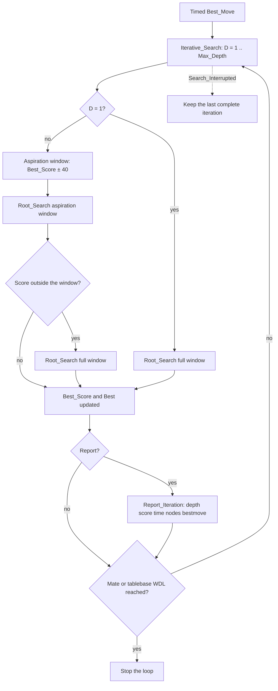
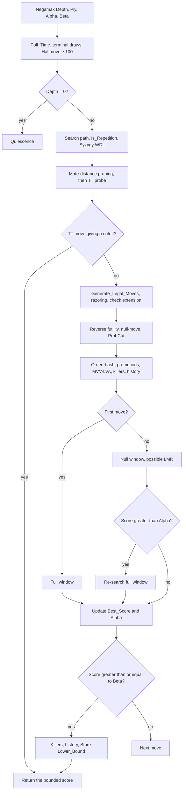

# BabaChess Search

This document describes the search algorithms of the **BabaChess** engine (unit
`BBChess.Search`, files `src/bbchess-search.ads` and `bbchess-search.adb`).
It explains the principles and the design choices, not the code line by line,
and keeps track of the techniques **kept**, **removed** and **under test**, in
line with `DEVELOPMENT.md`.

The search is a **negamax alpha-beta** with iterative deepening,
transposition table, PVS, quiescence and a set of modern pruning techniques. The
scores are in centipawns, from the point of view of the side to move (`Score_Type`, `Infinity`,
`Mate_Score` in `BBChess.Eval`).

`bbchess-search.ads` exposes `Best_Move (Position, Depth)` (fixed depth, for
the benches), `Best_Move (Position, Max_Depth, Time_Alloc)` (timed, entry
point of the multi-thread) and `Reset_Search` (empties table and heuristics between
two games, on `new` or `ucinewgame`). `Set_Game_History` transmits the keys of
the game for repetition, `Set_Post` enables the XBoard output, `Set_Threads`
sets the number of threads, and `Nodes_Searched` / `Reset_Nodes` feed the bench.

## Iterative deepening and aspiration windows

`Iterative_Search` loops from depth 1 up to `Max_Depth`. At each
iteration, `Root_Search` searches the root moves and returns the best as well
as its score, which serves as an anchor for the following iteration.

- **Iteration 1**: full window (`Alpha = -Infinity`, `Beta = Infinity`),
  for lack of a previous score.
- **Following iterations**: aspiration window of `Aspiration_Window = 40`
  centipawns around the previous score. If the score leaves the window (fail low
  or fail high), only the **bound crossed is widened**, by doubling the margin at
  each failure (`S_Asp_Grow`); beyond 1000 cp the window becomes full.
  Before §71 of `DEVELOPMENT.md`, any failure relaunched directly in full
  window.
- The iteration stops earlier in case of a mate found
  (`Abs (Best_Score) >= Mate_Score - 200`) or a tablebase result
  (`Abs (Best_Score) >= BBChess.Syzygy.TB_Win - 100`).

The main point of iterative deepening is not the score, but
**ordering**: the best move of depth `D` is searched first at `D+1`, which
produces beta cutoffs early and reduces the tree.

The search is **interruptible**: `Poll_Time` checks the deadline every
`Check_Interval = 1024` visits and raises `Search_Interrupted`. `Iterative_Search`
then keeps the move of the **last complete iteration**; if none has finished,
`Best_Move` falls back on `Quick_Move` (a legal move without search, tactics
first).

## Alpha-beta and PVS

`Negamax` is the heart of the search. The window `[Alpha, Beta]` bounds what
the side to move can hope for: a score `>= Beta` is a **fail high** (the node is too
good to be true), a score `<= Alpha` a **fail low**. The **PVS** search
(Principal Variation Search) is applied at the root as at each node:

1. The **first move** (the best ordered) is searched in full window
   `[-Beta, -Alpha]`.
2. The following moves are searched in **null window** `[-Alpha - 1, -Alpha]`,
   stricter therefore cheaper. If a move exceeds `Alpha`, it is
   **re-searched in full window**.

This mechanism is correct only if the ordering places the right move at the head:
that is where iterative deepening and move order meet. The
root (`Root_Search`) applies the same strategy, with `Prev_Best` at the head.

Two safeguards protect the scores: **mate-distance pruning** (score
bounded by `-Mate_Score + Ply` and `Mate_Score - Ply - 1`) and the **normalization
of mate scores in the TT** (`Adjust_Score` on read, `Store` on
write, shifted by the ply).

## Transposition table

The table stores a result per position already seen and is indexed by the **Zobrist
key** (`BBChess.Hash`).

### Zobrist

`BBChess.Hash` builds a 64-bit key by XOR of constants drawn from a
deterministic congruential generator (`Next_Random`, fixed seed):
`Piece_Key_Val (Piece, Square)`, `Side_Key_Val` for black to move,
`Castle_Key_Val (Color, Castle_Side)` and `Ep_Key_Val (File)` for the file of
en passant capture. `Hash.Compute` recomputes the complete key; during the
search, it is maintained **by incremental update** in `Make_Move`,
which reproduces exactly `Compute` (verified by the self-test).
`Set_Keys_Enabled` enables this computation, disabled by default so that perft does not
pay for hashing.

### Entry and buckets

The `Transposition_Table` table makes `TT_Size = 4_194_304` entries (4 194 304 ×
16 bytes = **64 MiB**). Each `TT_Entry` contains:

| Field      | Role |
|------------|------|
| `Hash_Key` | full Zobrist key, to confirm the identity of the position |
| `Depth`    | remaining search depth; `-1` means "empty" |
| `Bound`    | `Exact`, `Lower_Bound` or `Upper_Bound` |
| `Score`    | normalized score (mate shifted by the ply) |
| `Move`     | best move, encoded in 32 bits (`Pack_Move`) |
| `Age`      | search generation, for replacement |

Positions are stored in **two-way buckets**: `TT_Bucket`
computes an even index from the key (`Key and (TT_Mask - 1)`), and the probe
looks at the even index then the odd one. `Store` chooses the slot as follows: identical
key first, then empty slot, then entry too old
(`Age < TT_Generation`), then the shallowest entry. The write takes place only
if the new entry is at least as deep, if the key matches, or if
the old one is stale: **depth-preferred** replacement with aging.
`TT_Generation` is incremented at each `Best_Move`, so an entry from a
previous search gives way before a fresh entry.

The table **is not cleared between moves** ("Phase A"), only on
`Reset_Search`: the engine reuses nodes seen earlier in the game.
`Clear_Transposition_Table` clears entry by entry, and not by aggregate, so as not to
build the whole table on the stack. The cutoff is applied only if
`E.Depth >= Depth`; the TT move is extracted into `Hash_Move` even when the
depth is not sufficient, because it then serves for ordering.

## Move ordering

`Order` assigns an ordering score to each move; the loop of `Negamax`
sorts the list by selection. From the highest priority to the lowest:

1. **Transposition table move** (`Hash_Move`, score `100_000_000`).
2. **Promotions** (`50_000_000 + value of the promoted piece`).
3. **MVV-LVA captures** (`2_000_000 + 16 × victim - attacker`): *Most Valuable
   Victim, Least Valuable Attacker*, the most expensive piece captured by the least
   expensive; `Captured_Kind` handles en passant capture. A **losing** capture
   (attacker more expensive than the victim and `Static_Exchange_Value < 0`) goes
   on the other hand **after all quiet moves** (`-2_000_000 + ...`,
   `S_Bad_Capture`).
4. **Killers** (`1_000_000` and `900_000`): the two quiet moves having
   caused a beta cutoff at the same ply elsewhere, in `Ctx.Killers`.
5. **History**: the other quiet moves are ordered by
   `Ctx.History (color, From, To)`. `History_Bonus` is `depth²` capped at
   `1024` and `Bump_History` bounds it at `History_Max = 16_384`; a move that
   does not improve `Alpha` receives a **malus**, to also learn the bad
   moves. At each deepening iteration, `History` and `Cont_History`
   are **halved** (aging) so that the cutoffs of the previous iteration lose
   their weight instead of saturating `History_Max`.

In quiescence, the ordering is reduced: tactical moves at the head, sorted by
victim value (MVV), without killers or history.

## Quiescence

`Quiescence` extends the search beyond the horizon, because one cannot
statically evaluate a position in the middle of a series of exchanges. Its logic:

- **Transposition table** (`S_Qs_TT`): quiescence probes the TT (any
  entry of depth ≥ 0, cutoff according to the bound) and writes its results in
  depth 0, without ever overwriting an entry of the main search
  (depth ≥ 1).
- **Stand pat**: outside check, one evaluates the position (`Evaluate`); if the value
  reaches `Beta`, one cuts, if it exceeds `Alpha`, one adopts it.
- **In check**, no stand pat: all evasions are generated and
  searched, quiet moves included. Outside check, only the **tactical moves**
  are generated (`Generate_Legal_Tactical_Moves`).
- **Mate and stalemate** detected at the horizon: without a move available in check, the node
  returns `-(Mate_Score - Ply)`.
- **Delta pruning**: a capture whose victim plus `Delta_Margin = 200`
  does not reach `Alpha` is not searched.
- **SEE pruning**: a capture whose `Static_Exchange_Value` is negative is
  losing and skipped, except promotions and evasions in check.

The static exchange evaluation lives in `BBChess.See`: `Attackers_Of` lists
the attackers of a square (x-rays appear thanks to the updated occupancy),
`Weakest` chooses the least expensive **excluding pinned pieces**
(`Pin_Mask`), and `Exchange` unrolls the sequence recursively. A side can
**decline** (stay at 0), the king is admitted only as last attacker, and
`Static_Exchange_Value` handles promotions and en passant capture.

## Pruning and reductions

These techniques cut branches deemed useless. All of them first check
that the node is neither in check nor in a mate position.

- **Null-move pruning**: `Depth >= 3`, outside check, and only if the side has
  a piece other than a pawn (`Has_Non_Pawn`), to avoid the zugzwang of
  pawn endgames. The turn is passed (`Position.Side` inverted, en passant
  cancelled, key updated) and the node is searched with `Null_Reduction = 2` plies
  less; a score `>= Beta` cuts.
- **Reverse futility**: at `Depth <= 6` (`S_Rfp_Depth`), if the static
  evaluation minus `Futility_Margin + 80 × (Depth - 1)` (`S_Rfp_Step`) already
  reaches `Beta` (outside mate scores beyond depth 1), the node is
  returned as is.
- **Futility pruning**: at `Depth <= 2`, a quiet move whose static
  evaluation plus `Futility_Base = 120` times the depth cannot reach
  `Alpha` is skipped.
- **Razoring**: at `Depth <= 2`, if the static evaluation is well below
  `Alpha` (`Razor_Margin = 300` times the depth), the node is **checked by
  a quiescence**, returned if it does not climb back up to `Alpha`.
- **Late move pruning (LMP)**: at `Depth <= 3`, quiet moves beyond
  the index `4 + Depth²` are not searched; ordered last, they
  almost never improve the window.
- **Late move reduction (LMR)**: at `Depth >= 3`, from the 4th move and outside check,
  a quiet move receives the reduction of `LMR_Table` (`Compute_LMR`,
  `R = 0.75 + ln (depth) × ln (move) / 2.25`), adjusted by the **regime**: -1 ply
  at **PV** nodes (`Beta - Alpha > 1`), +1 ply at **cut** nodes (null window),
  and **never** a reduction for a **killer** nor for a move that **gives
  check** (tested after `Make_Move`, on the opponent's position). A fail-high of the
  reduced search is **always re-verified at full depth** (correction
  of Phase 0).
- **ProbCut**: see the "under experimentation" section.

## Check extension

A node where the side to move is **in check** searches its evasions **one ply deeper**
(`Child_Depth := Depth`), because they are forced and a sequence of checks must not
be truncated by the horizon. The mechanism is bounded by
`Ply <= Max_Ply - 4`. A more aggressive variant, which extended **every move
giving check**, was tried then removed (see below).

## Draws and dead ends

Before any table cutoff, `Negamax` handles draws: **`Halfmove >= 100`**
(50-move rule), **`Insufficient_Material`** (king alone against king alone, king
plus a minor piece against king, bishops of the same colour, with the guard
`Popcount (All_Occ) <= 4` which keeps the detection out of the hot path), and
**`Is_Repetition`**: a position already on the current line (`Ctx.Search_Path`)
is a draw from the second occurrence, while the game history
(`Ctx.Game_Keys`, `Max_Game_Keys = 512`) requires **three** occurrences. The
search only climbs back from the last irreversible move (`Position.Halfmove`).

## Threading: Lazy SMP

The timed `Best_Move` supports up to `Max_Threads = 16` threads
(`Set_Threads`, option `--threads` or UCI `Threads`), according to a **Lazy SMP**:

- The **transposition table is shared**: a thread exploits the nodes
  found by the others.
- Each thread has its own `Search_Context` (killers, history, repetition
  path, node counter, deadline), so the heuristics do not step
  on each other.
- The threads are **Ada tasks** (`task type Searcher`); the primary thread
  (`Id = 1`) reports the iterations, the others fill the TT.
- The stop goes through `Stop_Search`, a boolean `pragma Atomic` set by the
  primary thread and tested by `Poll_Time`. A protected barrier `Completion`
  (`Done.Wait_All`) waits for the end of all the threads.
- `Abort_Request` (`Request_Stop` / `Clear_Stop`, Phase 5) is a **second**
  stop request, external (UCI `stop`/`quit`): it is likewise tested by
  `Poll_Time` and is cleared only by `Clear_Stop`, at the start of a
  search. The `go nodes N` arms the `Node_Limit` field of the search context,
  also tested by `Poll_Time`, which bounds the overshoot to one polling
  interval (`Check_Interval = 1024` nodes). The XBoard "post" output and the UCI
  lines (`readyok`, `bestmove`) go through the protected lock `Console`
  (`Locked_Put_Line`), `Ada.Text_IO` not being safe under task concurrency.
- The result kept is that of the thread having reached the **greatest
  depth**, broken by the score; failing that, `Quick_Move`.

Writes to the TT are not locked. To keep races
benign, `Store` writes **the payload field by field, key last**, and the
probe **tests the key before copying** the entry: a slot is used
only if the new key is visible, therefore with an already consistent payload. An
old key on a half-written slot simply fails the key test.
Two threads can still write valid entries in the same slot
(the last key wins) or replace a slot between the test and the copy,
which only gives a key-consistent node, possibly shallower.

## Techniques kept, removed and under test

### Implemented and validated

- **Iterative deepening, PVS, aspiration windows** (iteration 1 in full
  window then ± 40 cp), two-way table with aging, ordering hash /
  promotions / MVV-LVA / killers / history.
- **TT 64 MiB**, **history aging** and **LMR regime** (PV -1 / cut +1,
  killers and moves giving check never reduced): batch measured at **+15 Elo** on
  two independent seeds (`DEVELOPMENT.md` §80).
- **Null-move pruning** (`Null_Reduction = 2`) and **reverse futility** at
  depth 1.
- **Phase 0 (correction)**: full re-search of every LMR fail-high, history
  quadratic with malus, terminal draws, mate-distance pruning. Neutral balance
  in A/B (10-9-21, around ± 9 Elo) but removes real errors: kept
  as a prerequisite.
- **Phase 1 (pruning)**: LMR log, LMP, futility pruning, razoring, delta
  pruning in quiescence. Tree divided by about 11 at depth 9 (7.6 M to
  0.67 M nodes), around **+61 Elo** in self-play and **+140 Elo** against GNU
  Chess (from 0-8-2 to 1-13-6).
- **SEE** in quiescence, promotion first, evasions always searched.
- **Check extension** of evasions, bounded by the ply.
- **Lazy SMP**: shared TT, per-thread context. At 1 s+0.1 s: 1 thread 2-9-9,
  4 threads around **+127 Elo**.
- **Syzygy WDL probe** in `Negamax` (win, loss, draw).

### Implemented and removed (neutral or negative)

- **Singular extensions**: implemented then **removed** (commit `f17f217`).
  The probe searched the same position at `(Depth - 1) / 2` with the TT move excluded;
  a SPRT of 300 games concluded **neutral** (`+4.6 ± 31.3` Elo, LOS 38.6%) for
  a cost in nodes (`--bench 11`: 2.62 M to 2.95 M, +12.5%). The parameter
  `Excluded` and all the wiring were removed with the probe.
- **Phase 2 "ordering"**: history persistent between moves,
  **countermove**, and **SEE** sorting of captures. Clear regression against GNU
  Chess (Phase 1: 8/30, Phase 2: 2/30) and SEE sorting at about 13% of knps
  less. **The whole batch was cancelled.**
- **Check extension of every move giving check**: tree multiplied by 2.8,
  without correcting the target move. **Reverted.**
- **"Recapture" extension** (capture on the square of the previous move): tree
  multiplied by 3.1, without effect on the target move. **Reverted.**
- **IID** (internal iterative deepening): +5% nodes, SPRT of 300 games
  **neutral** (`+6.9 ± 32.5` Elo). **Not kept.**
- **Quiet checks in quiescence**: fixed a diagnostic position
  but cost **+49% time** at almost equal nodes. **Discarded.**
- **Quiet checks in quiescence, constrained variant** (`S_QChecks`, first
  ply only, safety test `not Is_Attacked`): **+33 to +91% time** on
  `--bench`, SPRT `1+0.1` **FAIL** (**-34.7 ± 15.6** Elo, H0 accepted at 714
  games). Left **disabled** (default 0). Detail: `DEVELOPMENT.md` §81.
- **Continuation history 2-ply** (*follow-up*, second table keyed on the move
  two plies higher): **KNpS -5 to -7%** and SPRT `1+0.1` **INCONCLUSIVE**
  (**-9.0 ± 13.6** Elo, score 0.487), weight 2 likewise → **removed**. Detail:
  `DEVELOPMENT.md` §83.
- **"improving" flag** (eval now vs 2 plies before, to gate
  razor/RFP/futility/LMP, `S_Improving`): proposed variant **neutral** (0.501
  over 669 games), "relax if improving" variant **+53% tree**,
  "prune if non-improving" variant **not inert** flag off → **removed**.
  Detail: `DEVELOPMENT.md` §84.

### Under experimentation

- **ProbCut**: present in the working tree (not committed). At
  `Depth >= ProbCut_Min_Depth = 5`, outside check, one searches a small number of
  promising captures (`ProbCut_Max_Moves = 2`, those whose
  `Static_Exchange_Value >= ProbCut_Margin = 200`) with a **raised** beta window
  (`B + ProbCut_Margin`) and a reduced depth
  (`Depth - ProbCut_Depth = 4`). If this probe exceeds the raised bound, the node
  is considered refuted and the score is returned without paying the
  full-depth search. Standard technique (see the references), but **not yet
  validated**: it must pass `--selftest`, a stable `--bench`, then a
  SPRT campaign of several hundred games, as the singular
  extensions were.

## References

- [Alpha-Beta](https://www.chessprogramming.org/Alpha-Beta)
- [Principal Variation Search](https://www.chessprogramming.org/Principal_Variation_Search)
- [Iterative Deepening](https://www.chessprogramming.org/Iterative_Deepening)
- [Aspiration Windows](https://www.chessprogramming.org/Aspiration_Windows)
- [Transposition Table](https://www.chessprogramming.org/Transposition_Table)
- [Zobrist Hashing](https://www.chessprogramming.org/Zobrist_Hashing)
- [Move Ordering](https://www.chessprogramming.org/Move_Ordering)
- [Killer Heuristic](https://www.chessprogramming.org/Killer_Heuristic)
- [History Heuristic](https://www.chessprogramming.org/History_Heuristic)
- [Late Move Reductions](https://www.chessprogramming.org/Late_Move_Reductions)
- [Null Move Pruning](https://www.chessprogramming.org/Null_Move_Pruning)
- [Quiescence Search](https://www.chessprogramming.org/Quiescence_Search)
- [Static Exchange Evaluation](https://www.chessprogramming.org/Static_Exchange_Evaluation)
- [ProbCut](https://www.chessprogramming.org/ProbCut)
- [Lazy SMP](https://www.chessprogramming.org/Lazy_SMP)
